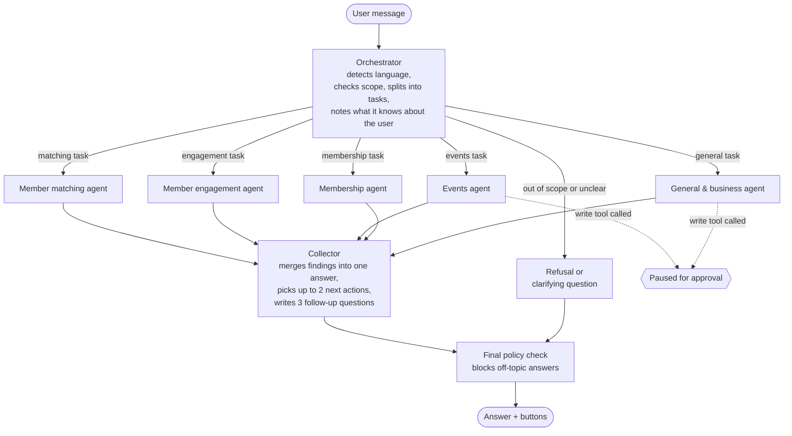
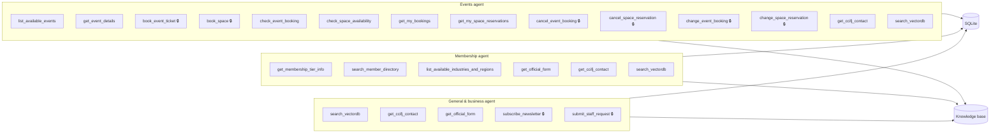
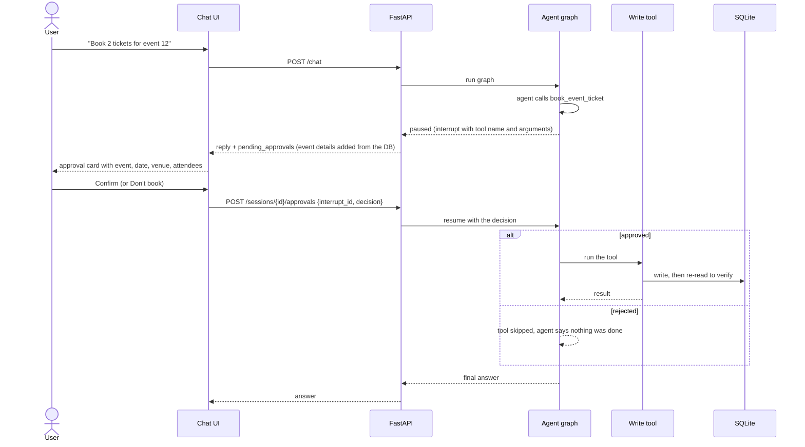
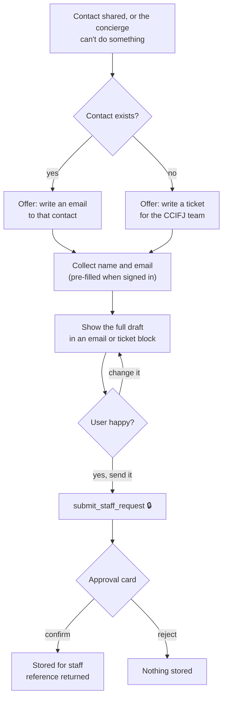
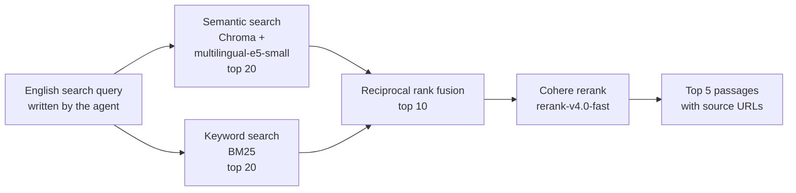
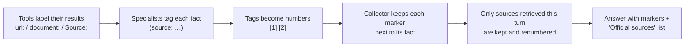

# CCIFJ Concierge

An AI concierge for the **Chambre de Commerce et d'Industrie France Japon (CCIFJ)**.
It answers questions about CCIFJ events, membership, business support, and
recruitment and training (for employers and job seekers) in
English, French, Japanese, or the user's own language. It can also take real
actions, such as booking event tickets or writing a message to CCIFJ staff, but
only after the user approves them.

```text
User ──► React chat ──► FastAPI ──► LangGraph agents ──► tools ──► SQLite · Chroma · BM25 · Cohere
```

---

## Contents

- [What the concierge can do](#what-the-concierge-can-do)
- [Architecture](#architecture)
- [How a message is answered](#how-a-message-is-answered)
- [Agents and tools](#agents-and-tools)
- [Extra agents: member matching and member engagement](#extra-agents-member-matching-and-member-engagement)
- [Staff view](#staff-view)
- [Approvals (human in the loop)](#approvals-human-in-the-loop)
- [Writing to CCIFJ staff](#writing-to-ccifj-staff)
- [Knowledge search (RAG)](#knowledge-search-rag)
- [Sources and citations](#sources-and-citations)
- [Updating what the concierge knows](#updating-what-the-concierge-knows)
- [Personal answers](#personal-answers)
- [How answers are written](#how-answers-are-written)
- [Buttons under an answer](#buttons-under-an-answer)
- [Project structure](#project-structure)
- [Getting started](#getting-started)
- [Configuration](#configuration)
- [API overview](#api-overview)
- [Database](#database)
- [Testing](#testing)
- [Installing it at CCIFJ](#installing-it-at-ccifj)
- [Declarations](#declarations)
- [Current limitations and tickets](#current-limitations-and-tickets)

---

## What the concierge can do

| Area | What it does |
|---|---|
| **Events** | Lists upcoming events (by topic keywords, name, format, city or region such as Kansai, or dates), shows full event details, books tickets for every attendee, and reserves the L'Espace@CCIFJ room. Booking requires login and approval. |
| **My bookings** | Shows the user's own bookings and room reservations. Before booking, checks whether registration is open, whether they already booked, whether it clashes with their schedule, and whether the room is free (suggesting free slots when it isn't). Cancels a booking or reservation, or changes it (another event, add or remove attendees, new dates) in one step, until it starts. Changes need login and approval. |
| **Membership** | Explains membership categories, fees, eligibility, and benefits, shares the application form, and searches 650+ member companies by industry and, when asked, by place (Tokyo, Kansai, a city…). |
| **Business support** | Knows the full CCIFJ offer across the 8 sections of ccifj.or.jp (Our Chamber, News, Membership, Events, Business Forum, Commercial Support, Recruitment/Training, Publications) and recommends the services that fit the user's stage: market studies, Business Connect, Expo+, sector missions, company setup, domiciliation, V.I.E, VAT recovery, recruitment, training, publications, and advertising. |
| **Contacts** | Gives the right CCIFJ person for events, speaking, sponsorship, BONJOUR FRANCE, membership, corporate news, market entry, and recruitment, and always offers to write the email together. |
| **Staff requests** | Writes an email to a CCIFJ contact, or a ticket for the CCIFJ team when no contact fits. It revises the draft with the user and stores it after the user approves. |
| **Newsletter** | Subscribes the user to general news, training announcements, or the @StudioCCIFJ podcast, after approval. |
| **Files** | Reads attached PDFs, images (PNG, JPEG), Word documents (DOCX), and text files, with OCR in English, French, and Japanese for scans and images. Up to 4 files per conversation, 5 MB each. The text goes to the agent as context; the chat only shows the file name. |
| **Member matching** (extra agent) | Finds the member companies that fit a need described in plain words, shows the directory record behind each match and why it fits, says what the record does not confirm, and prepares an introduction that CCIFJ staff review before anything is sent. |
| **Member engagement** (extra agent, for staff) | Lists the members who need a follow-up and the rule behind each, recommends the one event or service that fits a member's goal and activity, and drafts the personalised message in the member's language for staff to review. |
| **Staff view** | A page for CCIFJ staff: stored requests with their conversation and a status, recent conversations, members to follow up, and the contacts the concierge gives out, editable in place. |
| **Sources** | Every answer shows the official CCIFJ pages and approved documents its facts come from, as numbered markers in the text and a list under the answer. A source the tools did not return cannot be cited. |
| **Personal touch** | Answers first, then asks for the details that would let it tailor the advice (industry, country, B2B or B2C, stage). Knows the date and the signed-in user's bookings, membership (with the company's industry and location), and newsletter status. Remembers the last few exchanges, so it builds on earlier advice instead of repeating it. |
| **Safety** | Keeps to CCIFJ topics and refuses unrelated requests. It treats tool results and documents as data, not instructions. Every database write needs explicit approval. It never shows the user its internals (databases, tools, event IDs). |

---

## Architecture


| Layer | Technology |
|---|---|
| Frontend | React 18, TypeScript, Vite, lucide-react |
| API | FastAPI, Uvicorn, SQLModel / SQLAlchemy (async), Alembic |
| Agents | LangGraph, LangChain (`create_agent`, `HumanInTheLoopMiddleware`) |
| Models | OpenAI chat models (default), or local Qwen through Ollama |
| Retrieval | Chroma + `intfloat/multilingual-e5-small` embeddings, BM25 (`bm25s`), Cohere `rerank-v4.0-fast` |
| Files | pypdf, pypdfium2, Pillow, Tesseract (`eng+fra+jpn`), built-in DOCX and UTF-8 text reading |
| Tracing | LangSmith (optional) |

---

## How a message is answered

Every message goes through one LangGraph graph (`src/concierge/agents/body.py`).



1. **Orchestrator.** Detects the user's language and decides whether the request is in scope. It splits a request into tasks for one or more specialists: *"show me events and membership fees"* runs both in parallel. A market-entry or partner-finding request with a known industry goes to all three specialists: support services, member companies in that industry, and matching events and committees. It also notes which details about the user matter for the request (industry, home country, B2B or B2C, stage, timeline...), which ones are already known from the profile or the conversation, and which are missing.
2. **Answer first, then ask.** An advisory request (*"I want to expand to Japan"*) is answered in the first reply, even when nothing is known about the user: the answer gives the general path and ends by asking for the one to three details that would let it be tailored. When the user shares them, the next answer is specific to their case. Off-topic requests get a polite refusal; questions about the concierge itself get a short description of what it can do, without internals.
3. **Specialist agents.** Each one is a LangChain agent with its own prompt and tools (see below). It sees the recent conversation, any attached files, and the user's profile, and tags each fact with the page or document it came from. If one specialist fails (a tool or model error), the others still answer and the reply says which part could not be checked.
4. **Collector.** Merges what the specialists found into one answer in the user's language. It also sees the last 3 exchanges, so it builds on earlier advice and doesn't ask again for details the user skipped. It keeps the answer to about 250 words, names the 2 most relevant member companies when the directory found any, ends with one follow-up question, proposes up to 2 next actions, and writes 3 suggested questions for this user.
5. **Final policy check.** A second, cheaper model call makes sure the answer stays within CCIFJ topics. It uses the same scope definition as the orchestrator (`SCOPE_DEFINITION`) and also sees the previous assistant message, so follow-ups like "help me write an email to Nicolas" aren't mistaken for new, unrelated requests. Answers that only ask the user questions, staff drafts, and help for job seekers are always allowed; it blocks only answers that fulfill a plainly unrelated request (homework, coding, trivia).
6. **Pause.** If an agent calls a tool that writes to the database, the graph pauses and the user sees an approval card (see [Approvals](#approvals-human-in-the-loop)).

---

## Agents and tools



🔒 = needs the user's approval before it runs. Every agent also has
`return_to_main_menu`, which hands the conversation back to the orchestrator.

| Tool | Agent | What it does |
|---|---|---|
| `list_available_events` | Events | Upcoming events, 10 per page. Filters: `keyword` (comma-separated topic words searched in title and description as whole words, e.g. `"F&B, food, wine"`), `name`, `category` (the event **format**: Business event, Conference, Networking, Training; a topic passed here is rejected with the valid list), `location` (a city, venue, or region: Kanto, Kansai, Chubu, Kyushu, Hokkaido), and dates. |
| `get_event_details` | Events | One event's schedule, venue, price, registration deadline, languages, and speakers. |
| `book_event_ticket` 🔒 | Events | Books one ticket per attendee (name and email; phone optional). Requires login. Checks the registration deadline. |
| `book_space` 🔒 | Events | Reserves L'Espace@CCIFJ for a date range. Requires login. The database prevents overlapping reservations. |
| `check_event_booking` | Events | Whether the user can book an event: it exists, hasn't started, registration is open, not already booked, and any clash with their other bookings or reservations. Guests get only the registration status. |
| `check_space_availability` | Events | Whether a space is free for a time range: taken times, free gaps, and the next free slot of the same length. Guests may use it; other people's private reservations show only as "reserved". |
| `get_my_bookings` | Events | The user's bookings with reference (`CCIFJ-EVT-…`), event, date, and attendees. Can include past or cancelled ones. |
| `get_my_space_reservations` | Events | The user's room reservations with reference (`CCIFJ-SPC-…`), dates, and title. |
| `cancel_event_booking` 🔒 | Events | Cancels a whole booking (all tickets), allowed until the event starts. |
| `cancel_space_reservation` 🔒 | Events | Cancels a room reservation, allowed until it starts. |
| `change_event_booking` 🔒 | Events | Moves a booking to another event and/or replaces its attendee list, in one step. |
| `change_space_reservation` 🔒 | Events | Moves a reservation to new dates, or changes its title or attendee count, in one step. |
| `get_ccifj_contact` | Events, Membership, General | The direct contact for a topic: `events`, `become_speaker`, `become_sponsor`, `bonjour_france`, `membership`, `corporate_news`, `japanese_market_support`, `recruitment_and_hr`. |
| `search_vectordb` | Events, Membership, General | Hybrid search of the CCIFJ website and knowledge base (see [Knowledge search](#knowledge-search-rag)). |
| `get_membership_tier_info` | Membership | Membership categories, annual dues in JPY, eligibility, and benefits. |
| `search_member_directory` | Membership | Member companies by industry and/or place. Places are stored as address parts (Tokyo wards like `Minato-ku`, cities, French towns), so a region is matched as the wards and cities inside it ("Tokyo" covers the 23 wards; "Kansai" covers Osaka, Kyoto, Kobe, Nara…), as whole words. "Japan" means no filter. If a place has no members in that industry, it returns the industry's members elsewhere, with a note. |
| `list_available_industries_and_regions` | Membership | The directory industries, and the region names `search_member_directory` understands. |
| `get_official_form` | Membership, General | Official form links: membership application, business development inquiry, CV database. |
| `subscribe_newsletter` 🔒 | General | Subscribes an email to a CCIFJ newsletter. Requires login. |
| `submit_staff_request` 🔒 | General | Stores an email to one or more CCIFJ contacts, or a ticket for the team. Guests may use it. |

All write tools check their result after writing. If the result can't be
confirmed, they report it as uncertain and never retry on their own.

**Changing a booking.** The two `change_*` tools cancel the old booking and
create a new one behind the scenes. If the new one fails, the old one is
restored automatically. The user sees one approval card and hears "your booking
was changed", with a new reference. The agent checks first
(`check_event_booking`, `check_space_availability`) so it doesn't collect
details for something that can't go through.

---

## Extra agents: member matching and member engagement

**Claimed bonuses:** first extra agent = member matching (challenge 3); second
extra agent = member onboarding and engagement (challenge 2). Each is a
separate agent with its own prompt, tools, and approval step
(`langchain_agents.py`), reached through the same orchestrator as the main
concierge. No Prisme bonus is claimed.

Both work on **fictional data only**: the 50 fictional companies supplied by
CCIFJ (`src/concierge/data/network/fictional_members.csv`), and fictional join
dates, goals, and activity written for the prototype
(`fictional_member_engagement.json`). Every answer says so.

### Member matching

```text
"I am looking for a French food company with experience in Japanese distribution."
   -> matches, best first, each with: sectors · why it fits (from its record) ·
      what the record does not confirm · the best contact and their language
"Prepare an introduction to COMPANY 25. I am Marie Laurent from ..."
   -> draft in the contact's language, in an email card
"Store it."  -> approval card -> stored for CCIFJ staff (reference SR-2026-...)
```

| Minimum outcome | How it is met |
|---|---|
| A clear business need | The agent extracts sector, activity, country, and the experience asked for, and asks one question only when there is neither a sector nor an activity. |
| Supported matches | `find_member_matches` ranks the directory by meaning (embeddings) and by the record's own words, and returns each record in full. Reasons may only use those facts, and the answer states what a record does not confirm (for example that a company is French). A need nothing fits returns no match. |
| An introduction for review | The draft is shown, changed until the user agrees, then stored after an approval card. Nothing is sent: staff review it in the staff view. Only profiles marked "display in the online directory" are used. |

It also serves staff: *"find me 5 relevant members for this company and draft a
match-making proposal"* returns the five matches with one reusable proposal
paragraph each.

### Member onboarding and engagement

```text
"Which members need a follow-up?"
   -> list, most urgent first, each with its stage and the rule with its numbers
"Prepare the follow-up for Luc Nakamura."
   -> member context · one recommended event or service and why it fits him ·
      the message, in his preferred language, in an email card
"Store it."  -> approval card -> stored for staff review
```

The stage is set by fixed rules in code (`agents/network.py`,
`engagement_stage`), read top to bottom:

| Stage | Rule | The follow-up |
|---|---|---|
| Welcome | joined 14 days ago or less | welcome, ask about objectives, explain the member area and directory |
| Inactive | joined more than 60 days ago and no activity for 90 days or more | acknowledge the silence, one low-effort step, offer a call |
| No event yet | joined 60 days ago or less and no event attended | ONE upcoming event that fits their goal |
| Member area not used | joined 60 days ago or less and never signed in | how to sign in and use the directory |
| No service used yet | joined 180 days ago or less and no service used | ONE service that fits their goal |
| First-year check-in | joined about a year ago | review the year, plan the next |
| Active | none of the above | not listed |

| Minimum outcome | How it is met |
|---|---|
| Relevant member context | `get_member_engagement` returns the profile, goal, activity, the stage, and the rule that set it. |
| A useful recommendation | The agent searches the real upcoming events and the CCIFJ knowledge base and recommends one item the tools returned, with the reason it fits this member. |
| Personalised follow-up | The message names the member's goal, makes the one recommendation with its date and link, and is written in the member's preferred language. Staff approve it; nothing is sent automatically. |

Not built: sending through LINE or email (the message is stored for staff),
and reading real join dates and activity from Odoo.

Live checks: `python demo/agents_eval.py http://127.0.0.1:8000 /tmp/agents.json`
(results in [`demo/live_eval_results.md`](demo/live_eval_results.md)).

---

## Staff view

`/staff.html` on the frontend host (http://localhost:5173/staff.html in
development). It is **off until `CCIFJ_STAFF_KEY` is set** (12 characters or
more) in `.env`; staff then enter that key once per browser session. English,
French, and Japanese.

| Tab | What staff can do |
|---|---|
| Requests | Read every message, introduction, and member follow-up approved in the chat, open the conversation it came from, and set its status (new, in review, closed). |
| Conversations | Read recent conversations, with the user or "guest" and any request they led to. |
| Member follow-ups | See who needs a follow-up and why (fictional demo data). |
| Contacts | Edit the names, roles, phones, and emails the concierge gives out. The next answer uses them; no restart. |

A guest conversation is deleted when its tab closes, **unless it produced a
request for staff**: then it is kept so staff can read what led to the request.
The key is one shared secret for the prototype; in production the page should
sit behind CCIFJ's own staff login. API: `src/concierge/api/staff.py`.

---

## Approvals (human in the loop)

Tools that change data are wrapped in LangChain's `HumanInTheLoopMiddleware`
(`src/concierge/agents/langchain_agents.py`). Nothing is written until the user
confirms.



The approval card shows exactly what will happen before the user confirms:

| Action | The card shows |
|---|---|
| Book tickets | Event title, date, venue, price, registration deadline, and every attendee |
| Reserve a room | Space, start and end, title, attendees |
| Newsletter | The email and the newsletter name |
| Staff request | Type, To, From, Subject, and the full message |
| Cancel | The booking or reservation that will be cancelled |
| Change | Current → new, as one change |

Event and room details come from the database, not from the model. Booking,
room, newsletter, cancel, and change approvals need login. Guests can approve
staff requests only.

The paused state is kept in memory (`MemorySaver`), so run the API with **one
worker**.

---

## Writing to CCIFJ staff

When the concierge can't help on its own, it offers to write a message to the
right person together with the user. Examples: the registration deadline has
passed but the event hasn't happened yet, the user wants to cancel or change a
booking that has already started, asks for a refund, or no contact fits the
question.



Drafts always use the same layout, so they're easy to tell apart from the rest
of the answer:

````text
```email
To: t.funabashi@ccifj.or.jp; m.barges@ccifj.or.jp
From: Jane Doe <jane@example.com>
Subject: Membership category for a newly established company

Dear Ms. Funabashi and Ms. Barges,
...
```
````

The chat shows each draft as an email or ticket card with a Copy button. When
the user agrees, the request is saved in the `staff_request` table (one
`staff_request_recipient` row per contact), linked to the user (if signed in)
and the conversation. The user gets a reference such as `SR-2026-000001`.
Before the first draft, the concierge asks which language to write it in,
recommending English, French, or Japanese.

Requests are only stored for staff to review. No email is sent automatically.

---

## Knowledge search (RAG)

`search_vectordb` (`src/concierge/rag/`) combines meaning-based search with
keyword search, then reranks the results.



The knowledge base is built from crawled CCIFJ website pages
(`src/concierge/data/documents.jsonl`, split into `chunks.json`). The agents
write their search queries in English, because the index is in English, but
always answer in the user's language.

The Chroma collection is opened once per process (`rag_search.get_collection`,
also loaded by the startup warm-up). Opening a new client for every search used
to crash when an agent ran two searches in parallel.

**It keeps working when a dependency fails.** Reranking is an external call, and
a trial Cohere key allows 10 calls a minute while one market-entry question can
run six or more searches. The search therefore stays under a per-minute budget,
stops calling Cohere for a minute after a refusal, and falls back to the fused
ranking; identical searches are cached for 10 minutes. If the embedding model
cannot run on the machine's GPU it moves to the CPU, and if the search fails
altogether the agent is told to say so and offer a contact, never to answer
from memory.

**Which source wins.** CCIFJ records in SQLite (events, membership categories
and fees, the member directory, contacts, forms, the user's bookings) are the
source of truth. Website search is background only. When the two disagree on a
fact such as a fee or a date, the agents use the record and don't mention the
difference.

---

## Sources and citations

Every factual answer shows where its facts come from
(`src/concierge/agents/sources.py`).



| Kind of fact | Its source |
|---|---|
| Website content (services, offices, procedures…) | The crawled `ccifj.or.jp` page the passage came from |
| Brochures, rate cards, calendars | The approved document, cited by name (see the next section) |
| Membership categories and fees | The "How to become a member" page |
| Events | The event's own page, or the upcoming-events page |
| Member companies | The members' directory page |
| Contacts | The contact page of the department |
| Market context from web search | A Markdown link next to the fact, listed apart from official sources |

The model never supplies a source itself. A marker that points to a page or
document the tools did not return in this turn is removed, markers never
appear inside an email or ticket draft, and when an answer keeps no marker (a
table, a one-line answer) the best-ranked pages consulted are still listed.
Questions about the law, tax, customs duties, or product compliance are not
answered from the web or from memory: the concierge says so and points to the
Business Support team.

In the API, `sources` lists the cited sources first, in marker order (`[1]` is
the first item), each with `cited` and `official`; a document without a public
page has `"url": null`.

---

## Updating what the concierge knows

No code is needed. CCIFJ staff edit plain files or database rows, run one
command where noted, and the concierge answers from the new information.

| What changes | Where it lives | How to update it |
|---|---|---|
| Brochures, rate cards, calendars, fact sheets | `src/concierge/data/documents/*.md` | `uv run concierge-kb add "New brochure.pdf"` (PDF, DOCX, TXT, MD, or a folder), or edit the `.md` and run `uv run concierge-kb sync`. Remove last year's with `uv run concierge-kb remove "Title"`. |
| Website pages | `src/concierge/data/documents.jsonl` (the crawl) | Re-crawl, then `uv run python -m concierge.rag.src.index_init`, then `uv run concierge-kb sync` to put the documents back. |
| Events, membership categories and fees, member companies, the room | SQLite tables `event`, `member_category`, `member`, `space` | Edit the rows (any SQLite editor, or an import from Odoo/TYPO3). The next answer uses them; nothing to rebuild. |
| Contacts (names, roles, phones, emails) | `src/concierge/data/contacts.json` | Edit them in the staff view's **Contacts** tab, or edit the file. The next answer uses them; no restart. |
| Form links | `get_official_form` in `src/concierge/agents/tools.py` | Still in code: the one item that needs a developer today. |

```bash
uv run concierge-kb list      # what is in the folder and in the index
uv run concierge-kb add "Media Kit 2027.pdf"
uv run concierge-kb sync      # after editing or deleting a file by hand
```

Restart the API after `add`, `sync`, or `remove`. Scanned PDFs are read with
OCR. Text read from a PDF keeps the PDF's reading order, which can scramble
tables, so after adding a file with prices open its `.md` once and check that
each price sits next to what it is for. The 12 documents indexed today come
from the hackathon's approved source folder; see
[`src/concierge/data/documents/README.md`](src/concierge/data/documents/README.md).

---

## Personal answers

For a signed-in user, the API loads a small profile on every turn
(`crud.load_user_context`): name, email, membership (company, its industry,
country and region, and tier), newsletter status, upcoming bookings (with days
until each one), upcoming room reservations, **interests** (the event categories
they book most), and up to two **recommended events** (upcoming, registration
open, in those categories, not yet booked). Every prompt also gets the current
date and time in Japan and the turn number.

The concierge uses this to:
- avoid asking for details it already knows (a member's industry or country);
- avoid offering what the user already has (joining when already a member,
  booking an event they already booked, subscribing twice);
- pre-fill their name and email in bookings and staff requests;
- add **at most one** short personal note, such as a booked event coming up in
  the next 7 days, a registration deadline that's close, or an upcoming event
  that matches their interests.

**Knowing the user.** For advisory questions, the orchestrator decides which
details would change the answer (`known_user_details`, `missing_user_details`
in its plan). Every specialist gets those details with its task. The answer is
given straight away and ends by asking for the missing ones, once; if the user
does not give them, later answers stay general and do not ask again.

Guests get the same answers, without the personal parts. A guest who tries to
book is asked to sign in and keeps the same conversation; after signing in from
the chat, the widget continues it automatically.

---

## How answers are written

The collector's prompt (`COLLECTOR_SYSTEM_PROMPT` in `schema_prompts.py`) and
the shared blocks every agent gets (`CCIFJ_SERVICES_MAP`,
`PERSONALIZATION_GUIDE`, `USER_FACING_RULES`) set these rules:

| Rule | What it means |
|---|---|
| Build on the conversation | The collector sees the last 3 exchanges. It doesn't repeat earlier advice, links, or offers, and doesn't ask again for details the user skipped. |
| Short | About 250 words, the 2–3 recommendations that matter most, at most 3 items per list; the rest is offered as a follow-up. |
| Name members | When the directory found relevant members, the 2 most relevant are named, exactly as written, with their sector and a caveat that they're possible contacts. |
| End with a question | Every answer ends with one question that moves the user forward (a draft, a deeper topic). |
| No internals | Never mention databases, the knowledge base, tools, agents, or event IDs, and never say information "was not provided". Say what the user can do instead. |
| Exact names | Company, event, and people's names are copied character for character. |
| Links | Each URL once, as a Markdown link with a descriptive title; an event is linked on its title. |

---

## Buttons under an answer

| Kind | Source | Limit |
|---|---|---|
| **Next actions** (filled buttons) | The collector, from a fixed list: `event.view`, `event.book`, `events.browse`, `space.book`, `membership.join`, `membership.benefits`, `newsletter.subscribe`, `contact.staff`, `auth.login` | up to 2 |
| **Suggested questions** | Written by the model for this user, in their language: 3 related CCIFJ topics, spread across sections, that the answer and earlier turns haven't covered | at least 2 |

Three buttons in all, but there's always room for 2 suggested questions, so 2
actions + 2 questions is the most. Actions are checked against the user's real
situation before they're shown: no booking button for guests, no "join" for
members, no event button for an ID that isn't in the results, and no
`contact.staff` while a draft is already on screen. Action prompts name an
event by its title, never its ID, because the user sees them as their own
message.

**Useful links.** Links in the answer also appear as chips
(`api/presentation.py`, `NextActions.tsx`), but only when there are 2 or more
(a single link is already visible in the text):
- each page once (a trailing slash or `#anchor` doesn't make a new page);
- generic link text ("event page", "here", "details") is replaced by the page's
  own name from its URL;
- links that share a label are told apart by page name or section
  ("Events · Contact us", "Membership · Contact us");
- at most 3 at a time, with a "Show N more" toggle.

---

## Project structure

```text
src/concierge/
├── agents/              LangGraph graph, prompts, specialist agents, tools
│   ├── body.py              graph nodes: orchestrator, workers, collector, policy
│   ├── langchain_agents.py  the three specialist agents and their approval rules
│   ├── schema_prompts.py    prompts, structured outputs, next-action list
│   ├── tools.py             every agent tool
│   └── model.py             LLM setup (OpenAI or Ollama)
├── api/                 FastAPI routes: auth, sessions, chat, approvals, guided paths, attachments
├── auth/                password hashing and signed tokens
├── db/
│   ├── relationaldb/        SQLModel models, CRUD, Alembic migrations, demo seed, system.db
│   └── vectordb/            Chroma vector store
├── rag/                 hybrid retrieval (Chroma + BM25 + Cohere) and indexing
├── data/                crawled documents, chunks, Q&A catalogs, guided conversation paths
├── index/               BM25 index
├── config.py            settings from .env, checked at startup
└── main.py              FastAPI app
ccifj-frontend/          React + TypeScript chat site
tests/                   API contract tests (fake agent, throwaway database)
start.sh                 starts the whole stack with one command
```

---

## Getting started

### Requirements
- Python **3.12+** and [uv](https://docs.astral.sh/uv/)
- Node.js and npm
- An **OpenAI API key** (or Ollama with Qwen models) and a **Cohere API key**
- **Tesseract** with English, French, and Japanese language data, for image and scanned-PDF attachments

### 1. Configure

```bash
cp .env.example .env
```

Fill in `CCIFJ_AUTH_SECRET`, `OPENAI_API_KEY`, and `COHERE_API_KEY` (see
[Configuration](#configuration)). Generate the secret with:

```bash
python -c "import secrets; print(secrets.token_urlsafe(48))"
```

### 2a. Start everything with one command

```bash
./start.sh
```

It installs dependencies, applies database migrations, and starts the API on
port 8000 and the frontend on port 5173.

### 2b. Or start the pieces yourself

```bash
uv sync
uv run concierge-db upgrade
uv run uvicorn concierge.main:app --app-dir src --reload
```

In a second terminal:

```bash
cd ccifj-frontend
npm ci
npm run dev
```

Open **http://127.0.0.1:5173**. Vite forwards `/api` to the API on port 8000.
The interactive API docs are at http://127.0.0.1:8000/docs.

### 3. Optional: demo accounts

```bash
uv run concierge-db seed-demo
```

This creates two member accounts and one non-member account (password
`ccifj-demo-2026`). The first member also gets an upcoming booking and a
newsletter subscription. Running it again changes nothing.

> The API loads the agent and search models in the background when it starts
> (about 12–18 s). `GET /status` returns `"agent_ready": true` once they are
> loaded. A message sent before that waits for loading to finish.

---

## Configuration

Settings come from `.env` and are checked at startup (`src/concierge/config.py`).

| Variable | Required | Description |
|---|---|---|
| `CCIFJ_AUTH_SECRET` | yes | Secret for signing login tokens. |
| `model_type` | yes | `openai` (default) or `qwen` for local Ollama models. |
| `model_name` | yes | Main chat model. |
| `router_model_name` | yes | Model for routing and the final policy check. |
| `OPENAI_API_KEY` | with `openai` | OpenAI key. |
| `COHERE_API_KEY` | yes | Cohere key for knowledge-base reranking. |
| `trim_messages_max_token` | no | Conversation history kept per turn (default 1000 tokens). |
| `CCIFJ_AGENT_TIMEOUT_SECONDS` | no | Maximum time for one agent turn (default 180). |
| `CCIFJ_CORS_ORIGINS` | no | Comma-separated frontend origins allowed to call the API. |
| `CCIFJ_WEB_SEARCH` | no | `on` (default) or `off`: OpenAI web search for market context, for the events and general agents. |
| `CCIFJ_WEB_SEARCH_DOMAINS` | no | Comma-separated allowed domains, e.g. `ccifj.or.jp`. Default `*` (whole web). |
| `CCIFJ_WEB_SEARCH_CONTEXT` | no | `low` (default, fastest), `medium`, or `high`: how much each web search reads. |
| `CCIFJ_RERANK_PER_MINUTE` | no | Cohere rerank calls allowed per minute (default 9, under a trial key's 10). Raise it with a production key; `0` never calls Cohere. |
| `CCIFJ_RERANK_TIMEOUT` | no | Seconds to wait for one rerank before using the fused ranking (default 8). |
| `CCIFJ_DEBUG_FINDINGS` | no | Set to `1` to log what each specialist returned and which sources it tagged (diagnosis only; it logs user content). |
| `CCIFJ_EMBED_DEVICE` | no | Force the embedding model's device, e.g. `cpu`. By default it uses the GPU when it works and the CPU otherwise. |
| `CCIFJ_STAFF_KEY` | no | Turns the [staff view](#staff-view) on. 12 characters or more; without it the staff routes answer 404. |
| `ODOO_URL`, `ODOO_DB`, `ODOO_USER`, `ODOO_API_KEY` | no | When all four are set, approved staff requests are also created in Odoo as CRM leads (see [Installing it at CCIFJ](#installing-it-at-ccifj)). |
| `LANGSMITH_TRACING`, `LANGSMITH_API_KEY`, … | no | LangSmith tracing. Traces go to the project `<LANGSMITH_AGENT_ID>-<LANGSMITH_AGENT_ENVIRONMENT>` (e.g. `realhackathon-local`). Runs are listed by their start time, taken from this machine's clock: keep it synced, or runs recorded while it was wrong sort above newer ones. |

Frontend settings (`ccifj-frontend/.env.local`): `CCIFJ_API_TARGET` for the
development proxy, and optionally `VITE_API_BASE_URL`. Never put API keys in
frontend variables.

---

## API overview

Every route is available both at the root and under `/api/v1`. Full reference:
[`src/concierge/api/README.md`](src/concierge/api/README.md).

| Method | Route | Purpose |
|---|---|---|
| `GET` | `/health`, `/status` | Health; `/status` also reports `agent_ready` |
| `GET` | `/suggestions?locale=` | Catalog questions and guided-path starters for the welcome screen |
| `POST` | `/auth/register`, `/auth/login` | Create an account or sign in |
| `GET` | `/auth/me` | Current user |
| `POST` | `/sessions` | Start a conversation |
| `GET` | `/sessions/{id}/messages` | Conversation history |
| `POST` | `/sessions/{id}/claim` | Attach a guest conversation to an account after login |
| `POST` | `/sessions/{id}/reconcile` | Check the outcome of an interrupted action |
| `POST` | `/chat` | Send a message (with optional attachments) |
| `POST` | `/chat/stream` | Same, streamed as server-sent events (progress and text) |
| `WS` | `/chat/ws` | Same, over WebSocket |
| `GET` | `/sessions/{id}/approvals[/{interrupt_id}]` | Pending approvals |
| `POST` | `/sessions/{id}/approvals` | Approve or reject a pending action |

---

## Database

SQLite (`src/concierge/db/relationaldb/system.db`), with these tables:
`user`, `user_auth`, `session`, `message`, `event`, `event_language`,
`booking`, `ticket`, `member`, `member_category`, `belongs`, `speaker`,
`speaks_at`, `subscription`, `contact_us`, `space`, `space_reservation`,
`staff_request`, `staff_request_recipient`.

Guest sessions are deleted when the guest closes the app, and a guest's chat is
assigned to them as soon as they log in. See
[`src/concierge/db/README.md`](src/concierge/db/README.md) for the session
lifecycle and a changelog of database behavior changes.

### Schema updates

Run `uv run concierge-db upgrade` before starting the application, including
after pulling schema changes. It creates new databases and migrates existing
ones without replacing records.

After changing SQLModel models, generate a migration:

```bash
uv run concierge-db revision --autogenerate -m "describe the change"
```

Review it, including data conversions, before running
`uv run concierge-db upgrade`. SQLite table changes use Alembic batch mode.
Custom triggers and data migrations must be written into the revision by hand.
If you rebuild `space_reservation`, recreate its reservation guards afterward.
Use `uv run concierge-db current` to see the installed revision. Back up the
database before deploying schema changes, and apply migrations once before
starting the server.

### Dates and times

Event dates, registration deadlines, and room schedules are stored as naive
**Japan time (UTC+9)**. Dates that include a time zone are converted to Japan
time first. Creation and update timestamps stay in UTC. Registration closes at
the deadline, or at the event's end time when there is no deadline. The
database blocks overlapping confirmed room reservations, even across several
processes.

> `system.db` and the Chroma files change whenever you use the app. Avoid
> committing those local changes: add files by name instead of `git add .`.

---

## Testing

The backend tests use a fake agent and a throwaway database, so they need no
API keys (68 tests: API contract, staff requests and approvals, sources and
citations, search fallbacks, the Odoo connector with a simulated server, member
matching, engagement rules, editable contacts, and the staff view):

```bash
PYTHONPATH=src uv run --with httpx python -m unittest discover -s tests -v
```

Frontend tests (43 tests):

```bash
cd ccifj-frontend && npm test
```

### Live evaluation

Two scripts run real conversations against a running API (they use the API
keys and write to the local database):

```bash
python demo/live_eval.py  http://127.0.0.1:8000 /tmp/live_results.json    # 20 scenarios + 5 fallbacks
python demo/flows_eval.py http://127.0.0.1:8000 /tmp/flows_results.json   # bookings, approvals, safety, concurrency
python demo/agents_eval.py http://127.0.0.1:8000 /tmp/agents_results.json # member matching and member engagement
```

`live_eval.py` asks 20 questions taken from CCIFJ's recurring-question bank
(French, English, and Japanese) and 5 questions the concierge should not be
able to answer from its sources. `flows_eval.py` runs a staff request with
approval, a booking that is rejected, booked, changed, and cancelled, a set of
safety cases (out of scope, prompt injection, an invented event, an invented
member, a seat count), and four conversations at the same moment. Results of
the last run: [`demo/live_eval_results.md`](demo/live_eval_results.md).

---

## Installing it at CCIFJ

### 1. On the website (TYPO3)

The chat is a static site (`ccifj-frontend/dist` after `npm run build`) plus
the API. To put it on any page, add one line to the page template:

```html
<script src="https://CONCIERGE-HOST/embed.js" defer></script>
```

This shows a chat button at the bottom right and opens the concierge in a
panel. The chat runs in an iframe served from the concierge host, so the TYPO3
page needs no other change and shares no cookies with it.

| Attribute | Effect |
|---|---|
| `data-lang="fr"` | `en`, `fr` or `ja`. Default: the page's `<html lang>`, then the browser language. |
| `data-position="left"` | Button on the left. Default: right. |
| `data-open="true"` | Open the panel when the page loads. |

A page can open it from its own links with `window.__ccifjConcierge.open()`.
`/embed-demo.html` is an example host page. The full-page chat is also
available directly at `https://CONCIERGE-HOST/?lang=fr`.

### 2. The server

| Piece | What it needs |
|---|---|
| API | One small Linux server with 4 GB of RAM or more (the API process used about 2 GB in our runs); no GPU is needed, the embedding model runs on the CPU. Python 3.12+, `uv`, Tesseract with `eng`, `fra`, `jpn`. Run `uv sync`, `uv run concierge-db upgrade`, then Uvicorn with **one worker** behind a reverse proxy with HTTPS. |
| Frontend | Any static host for `ccifj-frontend/dist`. It must forward `/api` to the API, or be built with `VITE_API_BASE_URL` and listed in `CCIFJ_CORS_ORIGINS`. |
| Keys | `OPENAI_API_KEY`, `COHERE_API_KEY` (a production key lifts the 10 calls/minute trial limit; without it the search still works, unreranked, above that rate), `CCIFJ_AUTH_SECRET`. |
| Data | `system.db`, the Chroma folder, and the BM25 index are files: back them up with the server. |

### 3. Odoo, GetResponse, and CCIFJ accounts

| System | Today | Next step |
|---|---|---|
| **Odoo (CRM)** | Optional connector (`src/concierge/integrations/odoo.py`): with `ODOO_URL`, `ODOO_DB`, `ODOO_USER`, `ODOO_API_KEY` set, each approved staff request is also created as a `crm.lead` with the visitor's name, email, message, category, and the concierge reference. It uses Odoo's standard XML-RPC API and is covered by a test with a simulated server; **it has not been run against CCIFJ's Odoo yet**. A failure never loses the request: it is always stored locally first. | Try it on a test database; map categories to sales teams; import events and members from Odoo into the `event` and `member` tables on a schedule. |
| **GetResponse** | Newsletter subscriptions are stored in the `subscription` table only. | Push new rows to the GetResponse list. |
| **Member accounts** | The prototype has its own accounts. | Replace `/auth` with CCIFJ's member-area login so bookings and membership are the real ones. |
| **Event registration** | Bookings are stored in the prototype's database. | Call CCIFJ's registration system, or hand the user to the event's registration link (already in each event record). |

### 4. Running costs

No figures are given here because they depend on traffic and on the provider's
prices at the time; these are the items to budget, and LangSmith tracing (when
on) shows the real token counts per answer.

| Item | What drives it |
|---|---|
| Language model | 4 to 9 model calls per answer: 1 to route, 2 to 4 per specialist used (1 to 3 specialists), 1 to write the answer, 1 final scope check. |
| Web search | One billed call per search, only for market-context questions; `CCIFJ_WEB_SEARCH=off` removes it. |
| Reranking (Cohere) | One call per knowledge search, 1 to 6 per answer. |
| Hosting | One small server and static hosting. |
| Maintenance | Content: CCIFJ staff, no developer (see [Updating what the concierge knows](#updating-what-the-concierge-knows)). Code: dependency updates, model changes, and the integrations above need a developer. |

### 5. Before production

- Keep paused approvals across restarts (a persistent LangGraph checkpointer)
  so the API can run more than one worker.
- Move from SQLite to the database CCIFJ already operates if several
  services must write to it.
- Add a privacy notice: messages go to the model provider (OpenAI), search
  queries and passages to Cohere, and, when tracing is on, whole conversations
  to LangSmith.
- Decide how long conversations are kept. Guest conversations are deleted when
  the tab closes; the staff requests they produced are kept.

---

## Declarations

**External services.** OpenAI API (chat models and built-in web search);
Cohere API (reranking); LangSmith (optional tracing); Hugging Face Hub (one-time
download of the `intfloat/multilingual-e5-small` embedding model and the
`Qwen/Qwen3-Embedding-0.6B` tokenizer, both then run locally); Google Fonts
(the two typefaces of the frontend). Tesseract OCR runs locally.

**Data.** Public pages of ccifj.or.jp, crawled (including the public members'
directory: company names, sectors, and cities; no personal contact data);
event records taken from the same pages; the 12 brochures of the hackathon's
approved source folder, as text in `src/concierge/data/documents/`; the 50
fictional companies supplied for the hackathon
(`src/concierge/data/network/fictional_members.csv`), and fictional engagement
records written for the prototype (`fictional_member_engagement.json`). Staff
names, emails, and phone numbers in `get_ccifj_contact` are CCIFJ's published
contacts. Accounts and bookings in `system.db` are test data.

**AI tools.** Claude Code (Anthropic) was used on 9–10 November 2026 to review
the project, run the live evaluation, and write the changes of the
"reliability pass" listed below, including this README's new sections.

> **To complete by the team before submission:** other AI tools used during
> development, and code or work reused from before the hackathon (the
> repository history starts on 21 October 2026).

---

## Current limitations and tickets

### Answer quality: known gaps

Seen in live tests of the concierge and not fixed yet:
- When a fact differs for members and non-members (members-only events, 20% vs
  30% recruitment fees), the answer states both but doesn't say what membership
  would change for this user.
- A later turn can soften a recommendation made earlier (for example "both
  categories fit" after recommending Non-Resident), or describe a step the user
  hasn't taken as done ("your Non-Resident membership").
- Events named in an answer aren't always linked, and "not confirmed" or "not
  tracked" wording still slips through occasionally.
- Requests to find partners or clients don't always reach the events agent, so
  matchmaking events can be missed.
- Joining steps don't mention payment (card via Stripe) or the Start-up
  category's two-year limit.

### Done

Tickets 01–08 were implemented in PR #6 (backend and frontend support for the agent):

| Ticket | What changed |
|---|---|
| 01 | Files are sent to the backend and passed to the agent as context; DOCX and text files are supported. |
| 02 | Suggested questions show as outlined cards, different from the filled action buttons. |
| 03 | Staff requests are stored in `staff_request` with real references; guests can approve them. |
| 04 | Approval cards show every detail for bookings, rooms, newsletter, and staff requests. |
| 05 | Email and ticket drafts show as their own card with a Copy button. |
| 06 | The user profile includes interests and recommended events. |
| 07 | The agent loads at server start; `/status` reports `agent_ready`. |
| 08 | Approval messages and cards for cancelling and changing bookings. |

On `feature/concierge-tweaks` and `feature/concierge-answer-quality`:

| Change | Where |
|---|---|
| Asks for the user's details before advisory answers, once | orchestrator prompt and plan fields |
| Knows the 8 CCIFJ website sections and suggests related services | `CCIFJ_SERVICES_MAP` |
| Suggested questions written by the model (the 15 pre-written Q&A answers were removed) | orchestrator and collector |
| Link chips: deduplicated, readable labels, shown only for 2+ links, 3 at a time | `presentation.py`, `NextActions.tsx` |
| No internals in answers or loading messages | `USER_FACING_RULES`, `progress.py` |
| Guests sign in and continue the same conversation | `body.py`, `agent_backend.py`, `WidgetChat.tsx` |
| Answers build on the last 3 exchanges, name members, end with a question | collector |
| Market-entry requests go to all three agents | orchestrator prompt |
| Database facts win over website search | `USER_FACING_RULES` |
| Event search by topic keyword, format, and region | `list_available_events`, `crud.search_events` |
| Member search by region (wards and cities), with fallback | `search_member_directory` |
| One shared Chroma collection, so parallel searches no longer crash | `rag_search.get_collection` |

Reliability pass (9–10 November 2026):

| Change | Where |
|---|---|
| A rerank rate limit (Cohere trial key, 10 calls/minute) no longer fails the whole answer with a 502: per-minute budget, pause after a refusal, fused-ranking fallback, search cache | `rag/src/rag_search.py` |
| Embedding model falls back to the CPU on a GPU PyTorch cannot use; a failed search or a failed specialist no longer fails the answer | `agents/tools.py`, `agents/body.py` |
| Sources: numbered markers in answers, validated against what the tools returned, with an "Official sources" list in the chat | `agents/sources.py`, `agents/body.py`, `api/agent_backend.py`, `Sources.tsx`, `AnswerText.tsx` |
| Record tools (events, membership, directory, contacts) name their official page | `agents/tools.py` |
| The 12 approved brochures are in the knowledge base, with a no-code command to add, edit, and remove documents | `rag/src/documents.py`, `data/documents/` |
| Answers first, then asks for details (was: asked first) | orchestrator prompt |
| Legal, tax, customs, and compliance questions get a safe fallback, not a web answer; web search reads less per call (faster) | `WEB_SEARCH_RULES`, `agents/model.py` |
| No steps invented for procedures the sources do not describe (unsubscribe, invoices…) | `SOURCE_RULES` |
| Questions about the concierge itself are answered, without internals (was: "unrelated request") | orchestrator prompt |
| A rejected approval no longer shows a button for the same action; a changed booking is described as a change with the reference to keep | `agents/body.py`, `agents/tools.py`, events prompt |
| Language switcher (English, Français, 日本語) that remembers the choice | `App.tsx`, `site-copy.ts` |
| Embed script for any web page, with a demo host page | `ccifj-frontend/public/embed.js`, `embed-demo.html` |
| Optional Odoo connector: staff requests as CRM leads | `integrations/odoo.py` |
| Two extra agents: member matching (fictional directory, evidence, introduction for review) and member engagement (rules, one recommendation, follow-up draft) | `agents/network.py`, `agents/tools.py`, `langchain_agents.py`, `data/network/` |
| Staff view: requests with their conversation and status, conversations, members to follow up, editable contacts; guest conversations that led to a request are kept | `api/staff.py`, `ccifj-frontend/public/staff.html`, `agents/contacts.py`, `crud.py` |
| A short reply ("yes, store it") returns to the agent that handled the previous turn | `agent_backend.py`, orchestrator prompt |
| All frontend tests pass (5 checked site text that no longer existed); 29 new backend tests | `ccifj-frontend/src/*.test.tsx`, `tests/test_sources.py`, `tests/test_network.py` |

### Other known limits
- Event booking, room reservations, newsletter, cancel, and change require
  login. Guests can browse, check availability, and send staff requests.
- Conversation and approval state live in memory: restarting the API forgets
  paused approvals, and the API must run with one worker.
- The concierge can't cancel or change a booking once it has started, take
  payments, or issue refunds. It offers to write to staff instead.
- Form links are written into `get_official_form`; the `contact_us` table
  isn't used (contacts live in `data/contacts.json`).
- The staff view is protected by one shared key, not by staff accounts.
- The two extra agents use fictional data only, and anyone using the chat can
  reach them; in production the engagement agent must be limited to staff.
- The model usually follows the conversation rules, but not always: it may
  occasionally write a draft before asking for the language, or word buttons
  differently. Code-level checks enforce the important parts (button rules,
  approvals, booking step for a single event).
- **What is simulated.** Bookings, room reservations, and newsletter
  subscriptions are written to this prototype's own database. They are not
  sent to CCIFJ's real registration, payment, or GetResponse systems, and no
  confirmation email goes out. Staff requests are stored for staff (and sent to
  Odoo only when the optional connector is configured); no email is sent.
- Accounts are the prototype's own (`/auth/register`), not CCIFJ member-area
  logins.
- The scripts that crawled ccifj.or.jp and filled the `event` and `member`
  tables are not in this repository, so refreshing those needs them rerun or
  rewritten. Approved documents have their own command (`concierge-kb`).
- Only the English website pages are indexed. Approved documents are indexed
  in their own language (two French, one Japanese); questions in any language
  are searched in English.
- A typical answer takes 15 to 35 seconds; a market-entry question that uses
  all three specialists takes 50 to 60 seconds.
