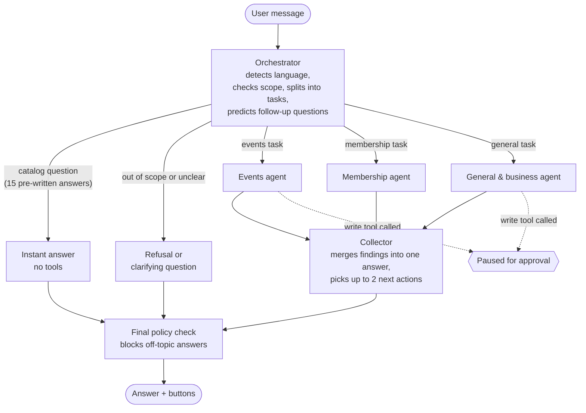
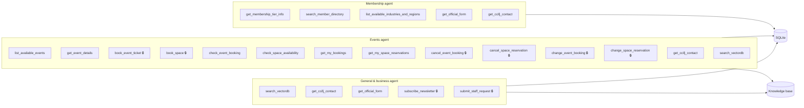
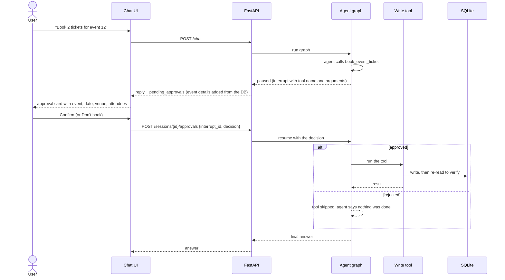
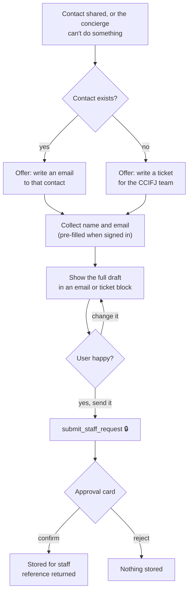
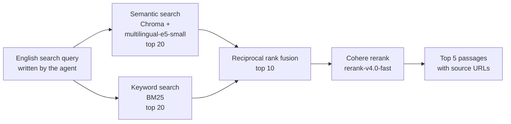

# CCIFJ Concierge

An AI concierge for the **Chambre de Commerce et d'Industrie France Japon (CCIFJ)**.
It answers questions about CCIFJ events, membership, and business support in
English, French, Japanese, or the user's own language. It can also take real
actions, such as booking event tickets or writing a message to CCIFJ staff, but
only after the user approves them.

```text
User ──► React chat ──► FastAPI ──► LangGraph agents ──► tools ──► SQLite · Chroma · BM25 · Cohere
```

---

## Contents

- [What the concierge can do](#what-the-concierge-can-do)
- [Architecture](#architecture)
- [How a message is answered](#how-a-message-is-answered)
- [Agents and tools](#agents-and-tools)
- [Approvals (human in the loop)](#approvals-human-in-the-loop)
- [Writing to CCIFJ staff](#writing-to-ccifj-staff)
- [Knowledge search (RAG)](#knowledge-search-rag)
- [Personal answers](#personal-answers)
- [Buttons under an answer](#buttons-under-an-answer)
- [Project structure](#project-structure)
- [Getting started](#getting-started)
- [Configuration](#configuration)
- [API overview](#api-overview)
- [Database](#database)
- [Testing](#testing)
- [Current limitations and tickets](#current-limitations-and-tickets)

---

## What the concierge can do

| Area | What it does |
|---|---|
| **Events** | Lists upcoming events (by name, category, place, or dates), shows full event details, books tickets for every attendee, and reserves the L'Espace@CCIFJ room. Booking requires login and approval. |
| **My bookings** | Shows the user's own bookings and room reservations. Before booking, checks whether registration is open, whether they already booked, whether it clashes with their schedule, and whether the room is free (suggesting free slots when it isn't). Cancels a booking or reservation, or changes it (another event, add or remove attendees, new dates) in one step, until it starts. Changes need login and approval. |
| **Membership** | Explains membership categories, fees, eligibility, and benefits, shares the application form, and searches 650+ member companies by industry or region. |
| **Business support** | Answers from CCIFJ's knowledge base: company setup in Japan, domiciliation, VAT recovery, HR and recruitment, CV registration, corporate news, and media. |
| **Contacts** | Gives the right CCIFJ person for events, speaking, sponsorship, BONJOUR FRANCE, membership, corporate news, market entry, and recruitment, and always offers to write the email together. |
| **Staff requests** | Writes an email to a CCIFJ contact, or a ticket for the CCIFJ team when no contact fits. It revises the draft with the user and stores it after the user approves. |
| **Newsletter** | Subscribes the user to general news, training announcements, or the @StudioCCIFJ podcast, after approval. |
| **Files** | Reads text from attached PDFs and images, with OCR in English, French, and Japanese. |
| **Personal touch** | Knows the date and the signed-in user's bookings, membership, and newsletter status. It can remind them of an event coming up soon or suggest one that matches their interests. |
| **Safety** | Keeps to CCIFJ topics and refuses unrelated requests. It treats tool results and documents as data, not instructions. Every database write needs explicit approval. |

---

## Architecture


| Layer | Technology |
|---|---|
| Frontend | React 18, TypeScript, Vite, lucide-react |
| API | FastAPI, Uvicorn, SQLModel / SQLAlchemy (async), Alembic |
| Agents | LangGraph, LangChain (`create_agent`, `HumanInTheLoopMiddleware`) |
| Models | OpenAI chat models (default), or local Qwen through Ollama |
| Retrieval | Chroma + `intfloat/multilingual-e5-small` embeddings, BM25 (`bm25s`), Cohere `rerank-v4.0-fast` |
| Files | pypdf, pypdfium2, Pillow, Tesseract (`eng+fra+jpn`) |
| Tracing | LangSmith (optional) |

---

## How a message is answered

Every message goes through one LangGraph graph (`src/concierge/agents/body.py`).



1. **Orchestrator.** Detects the user's language and decides whether the request is in scope. It splits a request into tasks for one or more specialists: *"show me events and membership fees"* runs both in parallel. It also picks up to 3 likely follow-up questions from the catalog.
2. **Shortcuts.** A question that matches one of the 15 catalog questions (in English, French, or Japanese) gets its pre-written answer straight away. Off-topic requests get a polite refusal.
3. **Specialist agents.** Each one is a LangChain agent with its own prompt and tools (see below). It sees the recent conversation, any attached files, and the user's profile.
4. **Collector.** Merges what the specialists found into one answer in the user's language. It formats the answer, adds at most one personal note, and proposes up to 2 next actions.
5. **Final policy check.** A second, cheaper model call makes sure the answer stays within CCIFJ topics.
6. **Pause.** If an agent calls a tool that writes to the database, the graph pauses and the user sees an approval card (see [Approvals](#approvals-human-in-the-loop)).

---

## Agents and tools



🔒 = needs the user's approval before it runs. Every agent also has
`return_to_main_menu`, which hands the conversation back to the orchestrator.

| Tool | Agent | What it does |
|---|---|---|
| `list_available_events` | Events | Upcoming events, filtered by name, category, location, and date range, 10 per page. |
| `get_event_details` | Events | One event's schedule, venue, price, registration deadline, languages, and speakers. |
| `book_event_ticket` 🔒 | Events | Books one ticket per attendee (name and email; phone optional). Requires login. Checks the registration deadline. |
| `book_space` 🔒 | Events | Reserves L'Espace@CCIFJ for a date range. Requires login. The database prevents overlapping reservations. |
| `check_event_booking` | Events | Whether the user can book an event: it exists, hasn't started, registration is open, not already booked, and any clash with their other bookings or reservations. Guests get only the registration status. |
| `check_space_availability` | Events | Whether a space is free for a time range: taken times, free gaps, and the next free slot of the same length. Guests may use it; other people's private reservations show only as "reserved". |
| `get_my_bookings` | Events | The user's bookings with reference (`CCIFJ-EVT-…`), event, date, and attendees. Can include past or cancelled ones. |
| `get_my_space_reservations` | Events | The user's room reservations with reference (`CCIFJ-SPC-…`), dates, and title. |
| `cancel_event_booking` 🔒 | Events | Cancels a whole booking (all tickets), allowed until the event starts. |
| `cancel_space_reservation` 🔒 | Events | Cancels a room reservation, allowed until it starts. |
| `change_event_booking` 🔒 | Events | Moves a booking to another event and/or replaces its attendee list, in one step. |
| `change_space_reservation` 🔒 | Events | Moves a reservation to new dates, or changes its title or attendee count, in one step. |
| `get_ccifj_contact` | Events, Membership, General | The direct contact for a topic: `events`, `become_speaker`, `become_sponsor`, `bonjour_france`, `membership`, `corporate_news`, `japanese_market_support`, `recruitment_and_hr`. |
| `search_vectordb` | Events, General | Hybrid search of the CCIFJ website and knowledge base (see [Knowledge search](#knowledge-search-rag)). |
| `get_membership_tier_info` | Membership | Membership categories, annual dues in JPY, eligibility, and benefits. |
| `search_member_directory` | Membership | Member companies by industry and/or region. |
| `list_available_industries_and_regions` | Membership | The industries and regions you can search by. |
| `get_official_form` | Membership, General | Official form links: membership application, business development inquiry, CV database. |
| `subscribe_newsletter` 🔒 | General | Subscribes an email to a CCIFJ newsletter. Requires login. |
| `submit_staff_request` 🔒 | General | Stores an email to one or more CCIFJ contacts, or a ticket for the team. Guests may use it. |

All write tools check their result after writing. If the result can't be
confirmed, they report it as uncertain and never retry on their own.

**Changing a booking.** The two `change_*` tools cancel the old booking and
create a new one behind the scenes. If the new one fails, the old one is
restored automatically. The user sees one approval card and hears "your booking
was changed", with a new reference. The agent checks first
(`check_event_booking`, `check_space_availability`) so it doesn't collect
details for something that can't go through.

---

## Approvals (human in the loop)

Tools that change data are wrapped in LangChain's `HumanInTheLoopMiddleware`
(`src/concierge/agents/langchain_agents.py`). Nothing is written until the user
confirms.



The paused state is kept in memory (`MemorySaver`), so run the API with **one
worker**.

---

## Writing to CCIFJ staff

When the concierge can't help on its own, it offers to write a message to the
right person together with the user. Examples: the registration deadline has
passed but the event hasn't happened yet, the user wants to cancel or change a
booking that has already started, asks for a refund, or no contact fits the
question.



Drafts always use the same layout, so they're easy to tell apart from the rest
of the answer:

````text
```email
To: t.funabashi@ccifj.or.jp; m.barges@ccifj.or.jp
From: Jane Doe <jane@example.com>
Subject: Membership category for a newly established company

Dear Ms. Funabashi and Ms. Barges,
...
```
````

Requests are only stored for staff to review. No email is sent automatically.

---

## Knowledge search (RAG)

`search_vectordb` (`src/concierge/rag/`) combines meaning-based search with
keyword search, then reranks the results.



The knowledge base is built from crawled CCIFJ website pages
(`src/concierge/data/documents.jsonl`, split into `chunks.json`). The agents
write their search queries in English, because the index is in English, but
always answer in the user's language.

---

## Personal answers

For a signed-in user, the API loads a small profile on every turn
(`crud.load_user_context`): name, email, membership (company and tier),
newsletter status, upcoming bookings, and upcoming room reservations. Every
prompt also gets the current date and time in Japan and the turn number.

The concierge uses this to:
- avoid offering what the user already has (joining when already a member,
  booking an event they already booked, subscribing twice);
- pre-fill their name and email in bookings and staff requests;
- add **at most one** short personal note, such as a booked event coming up in
  the next 7 days, a registration deadline that's close, or an upcoming event
  that matches their interests.

Guests get the same answers, without the personal parts.

---

## Buttons under an answer

| Kind | Source | Limit |
|---|---|---|
| **Next actions** (filled buttons) | The collector, from a fixed list: `event.view`, `event.book`, `events.browse`, `space.book`, `membership.join`, `membership.benefits`, `newsletter.subscribe`, `contact.staff`, `auth.login` | up to 2 |
| **Suggested questions** | The orchestrator, from the 15-question catalog | fill the rest |

There are **at most 3 buttons** in total. Actions are checked against the user's
real situation before they're shown: no booking button for guests, no "join"
for members, no event button for an ID that isn't in the results, and no
`contact.staff` while a draft is already on screen.

---

## Project structure

```text
src/concierge/
├── agents/              LangGraph graph, prompts, specialist agents, tools
│   ├── body.py              graph nodes: orchestrator, workers, collector, policy
│   ├── langchain_agents.py  the three specialist agents and their approval rules
│   ├── schema_prompts.py    prompts, structured outputs, next-action list
│   ├── tools.py             every agent tool
│   └── model.py             LLM setup (OpenAI or Ollama)
├── api/                 FastAPI routes: auth, sessions, chat, approvals, guided paths, attachments
├── auth/                password hashing and signed tokens
├── db/
│   ├── relationaldb/        SQLModel models, CRUD, Alembic migrations, demo seed, system.db
│   └── vectordb/            Chroma vector store
├── rag/                 hybrid retrieval (Chroma + BM25 + Cohere) and indexing
├── data/                crawled documents, chunks, Q&A catalogs, guided conversation paths
├── index/               BM25 index
├── config.py            settings from .env, checked at startup
└── main.py              FastAPI app
ccifj-frontend/          React + TypeScript chat site
tests/                   API contract tests (fake agent, throwaway database)
tickets/                 open work for the backend and frontend
start.sh                 starts the whole stack with one command
```

---

## Getting started

### Requirements
- Python **3.12+** and [uv](https://docs.astral.sh/uv/)
- Node.js and npm
- An **OpenAI API key** (or Ollama with Qwen models) and a **Cohere API key**
- **Tesseract** with English, French, and Japanese language data, for image and scanned-PDF attachments

### 1. Configure

```bash
cp .env.example .env
```

Fill in `CCIFJ_AUTH_SECRET`, `OPENAI_API_KEY`, and `COHERE_API_KEY` (see
[Configuration](#configuration)). Generate the secret with:

```bash
python -c "import secrets; print(secrets.token_urlsafe(48))"
```

### 2a. Start everything with one command

```bash
./start.sh
```

It installs dependencies, applies database migrations, and starts the API on
port 8000 and the frontend on port 5173.

### 2b. Or start the pieces yourself

```bash
uv sync
uv run concierge-db upgrade
uv run uvicorn concierge.main:app --app-dir src --reload
```

In a second terminal:

```bash
cd ccifj-frontend
npm ci
npm run dev
```

Open **http://127.0.0.1:5173**. Vite forwards `/api` to the API on port 8000.
The interactive API docs are at http://127.0.0.1:8000/docs.

### 3. Optional: demo accounts

```bash
uv run concierge-db seed-demo
```

This creates two member accounts and one non-member account (password
`ccifj-demo-2026`). The first member also gets an upcoming booking and a
newsletter subscription. Running it again changes nothing.

> The first message after the server starts is slower (about 12–18 s), because
> the agent and search models load on first use. See ticket 07.

---

## Configuration

Settings come from `.env` and are checked at startup (`src/concierge/config.py`).

| Variable | Required | Description |
|---|---|---|
| `CCIFJ_AUTH_SECRET` | yes | Secret for signing login tokens. |
| `model_type` | yes | `openai` (default) or `qwen` for local Ollama models. |
| `model_name` | yes | Main chat model. |
| `router_model_name` | yes | Model for routing and the final policy check. |
| `OPENAI_API_KEY` | with `openai` | OpenAI key. |
| `COHERE_API_KEY` | yes | Cohere key for knowledge-base reranking. |
| `trim_messages_max_token` | no | Conversation history kept per turn (default 1000 tokens). |
| `CCIFJ_AGENT_TIMEOUT_SECONDS` | no | Maximum time for one agent turn (default 180). |
| `CCIFJ_CORS_ORIGINS` | no | Comma-separated frontend origins allowed to call the API. |
| `LANGSMITH_TRACING`, `LANGSMITH_API_KEY`, … | no | LangSmith tracing. |

Frontend settings (`ccifj-frontend/.env.local`): `CCIFJ_API_TARGET` for the
development proxy, and optionally `VITE_API_BASE_URL`. Never put API keys in
frontend variables.

---

## API overview

Every route is available both at the root and under `/api/v1`. Full reference:
[`src/concierge/api/README.md`](src/concierge/api/README.md).

| Method | Route | Purpose |
|---|---|---|
| `GET` | `/health`, `/status` | Health and readiness |
| `GET` | `/suggestions?locale=` | Catalog questions and guided-path starters for the welcome screen |
| `POST` | `/auth/register`, `/auth/login` | Create an account or sign in |
| `GET` | `/auth/me` | Current user |
| `POST` | `/sessions` | Start a conversation |
| `GET` | `/sessions/{id}/messages` | Conversation history |
| `POST` | `/sessions/{id}/claim` | Attach a guest conversation to an account after login |
| `POST` | `/sessions/{id}/reconcile` | Check the outcome of an interrupted action |
| `POST` | `/chat` | Send a message (with optional attachments) |
| `POST` | `/chat/stream` | Same, streamed as server-sent events (progress and text) |
| `WS` | `/chat/ws` | Same, over WebSocket |
| `GET` | `/sessions/{id}/approvals[/{interrupt_id}]` | Pending approvals |
| `POST` | `/sessions/{id}/approvals` | Approve or reject a pending action |

---

## Database

SQLite (`src/concierge/db/relationaldb/system.db`), with these tables:
`user`, `user_auth`, `session`, `message`, `event`, `event_language`,
`booking`, `ticket`, `member`, `member_category`, `belongs`, `speaker`,
`speaks_at`, `subscription`, `contact_us`, `space`, `space_reservation`.

### Schema updates

Run `uv run concierge-db upgrade` before starting the application, including
after pulling schema changes. It creates new databases and migrates existing
ones without replacing records.

After changing SQLModel models, generate a migration:

```bash
uv run concierge-db revision --autogenerate -m "describe the change"
```

Review it, including data conversions, before running
`uv run concierge-db upgrade`. SQLite table changes use Alembic batch mode.
Custom triggers and data migrations must be written into the revision by hand.
If you rebuild `space_reservation`, recreate its reservation guards afterward.
Use `uv run concierge-db current` to see the installed revision. Back up the
database before deploying schema changes, and apply migrations once before
starting the server.

### Dates and times

Event dates, registration deadlines, and room schedules are stored as naive
**Japan time (UTC+9)**. Dates that include a time zone are converted to Japan
time first. Creation and update timestamps stay in UTC. Registration closes at
the deadline, or at the event's end time when there is no deadline. The
database blocks overlapping confirmed room reservations, even across several
processes.

> `system.db` and the Chroma files change whenever you use the app. Avoid
> committing those local changes: add files by name instead of `git add .`.

---

## Testing

The contract tests use a fake agent and a throwaway database, so they need no
API keys:

```bash
PYTHONPATH=src uv run --with httpx python -m unittest discover -s tests -v
```

Frontend tests:

```bash
cd ccifj-frontend && npm test
```

---

## Current limitations and tickets

Open work outside the agent is described in [`tickets/`](tickets/):

| Ticket | Summary |
|---|---|
| [01](tickets/01-frontend-send-attachments-to-backend.md) | The frontend puts extracted file text into the message; it should send the files to the backend instead. |
| [02](tickets/02-frontend-suggested-question-card-style.md) | Suggested-question buttons look like broken cards. |
| [03](tickets/03-backend-staff-request-table-and-approval.md) | Staff requests: database table (currently a mock reference) and approvals for guests. |
| [04](tickets/04-frontend-approval-card-details.md) | Approval cards should show every detail for space, newsletter, and staff requests. |
| [05](tickets/05-frontend-render-email-and-ticket-drafts.md) | Show email and ticket drafts as their own card. |
| [06](tickets/06-backend-user-context-interests.md) | Add interests and recommended events to the user profile. |
| [07](tickets/07-backend-preload-agent-at-startup.md) | Load the agent when the server starts, to remove the first-message delay. |
| [08](tickets/08-approval-cards-for-cancel-and-change.md) | Approval cards and messages for cancelling and changing bookings (currently generic text and raw details). |

Other known limits:
- Conversation and approval state live in memory: restarting the API forgets
  paused approvals, and the API must run with one worker.
- The concierge can't cancel or change a booking once it has started, take
  payments, or issue refunds. It offers to write to staff instead.
- CCIFJ contacts are written into `get_ccifj_contact`; the `contact_us` table
  isn't used yet.
