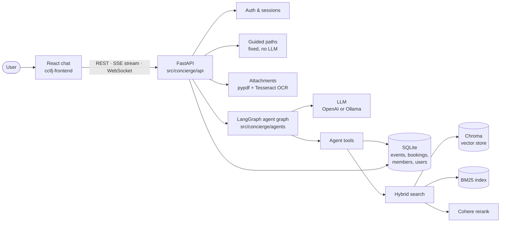
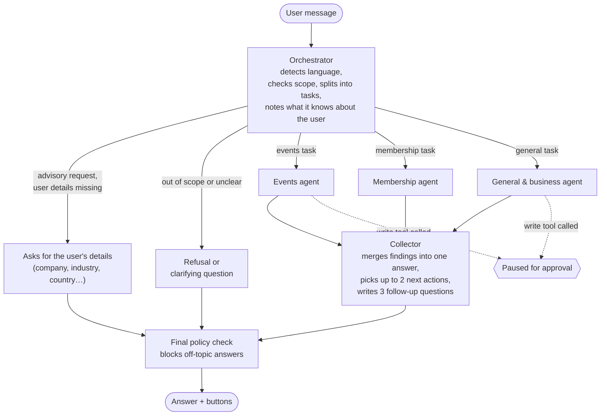
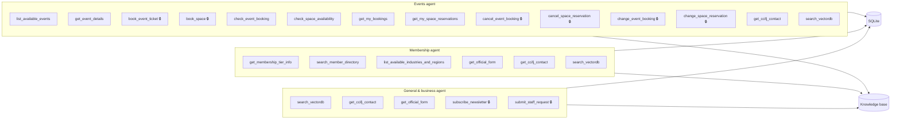
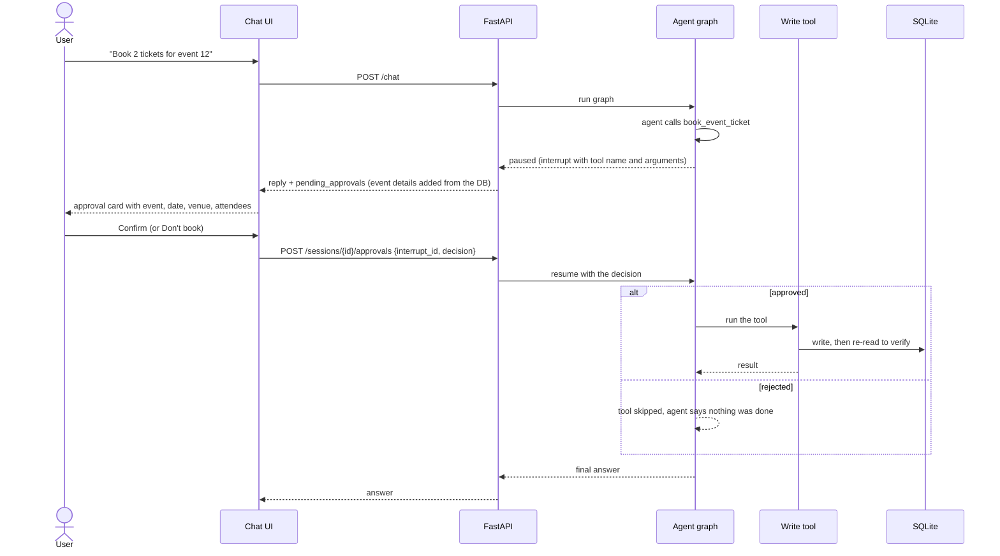
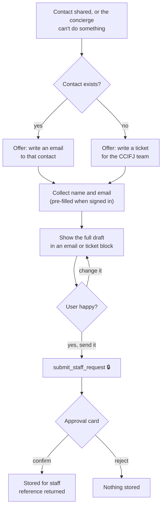
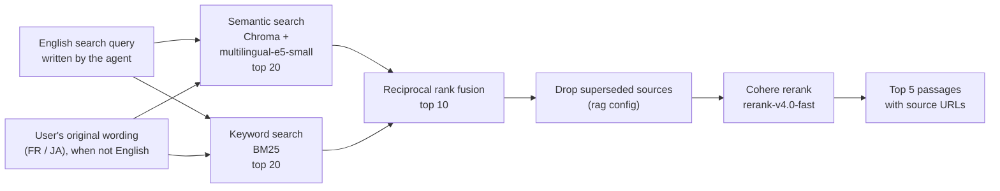

# CCIFJ Concierge

For a complete account of the changes, benefits, tradeoffs and validation limits, see [Changes README](CHANGES_README.md).

An AI concierge for the **Chambre de Commerce et d'Industrie France Japon (CCIFJ)**.
It answers questions about CCIFJ events, membership, business support, and
recruitment and training (for employers and job seekers) in
English, French, Japanese, or the user's own language. It can also take real
actions, such as booking event tickets or writing a message to CCIFJ staff, but
only after the user approves them.

For the demo, staff inbox setup, evaluation commands and rehearsal sequence, see
the [hackathon runbook](docs/HACKATHON.md). [Deployment](docs/DEPLOYMENT.md) covers
the TYPO3 / Odoo / GetResponse integration path, no-code content updates, recurring
costs and maintenance roles; [Hackathon data check](docs/HACKATHON_DATA_CHECK.md)
compares the implementation with the organisers' data pack.
The [concierge behavior upgrade](docs/CONCIERGE_UPGRADE.md) explains the current
memory, database-answer paths, event filters and version-checked conversation tests.

```text
User ──► React chat ──► FastAPI ──► LangGraph agents ──► tools ──► SQLite · Chroma · BM25 · Cohere
```

---

## Contents

- [What the concierge can do](#what-the-concierge-can-do)
- [Architecture](#architecture)
- [How a message is answered](#how-a-message-is-answered)
- [Agents and tools](#agents-and-tools)
- [Approvals (human in the loop)](#approvals-human-in-the-loop)
- [Writing to CCIFJ staff](#writing-to-ccifj-staff)
- [Knowledge search (RAG)](#knowledge-search-rag)
- [Personal answers](#personal-answers)
- [How answers are written](#how-answers-are-written)
- [Buttons under an answer](#buttons-under-an-answer)
- [Project structure](#project-structure)
- [Getting started](#getting-started)
- [Configuration](#configuration)
- [API overview](#api-overview)
- [Database](#database)
- [Testing](#testing)
- [Current limitations and tickets](#current-limitations-and-tickets)

---

## What the concierge can do

| Area | What it does |
|---|---|
| **Events** | Lists upcoming events (by topic keywords, name, format, city or region such as Kansai, or dates), shows full event details, books tickets for every attendee, and reserves the L'Espace@CCIFJ room. Booking requires login and approval. |
| **My bookings** | Shows the user's own bookings and room reservations. Before booking, checks whether registration is open, whether they already booked, whether it clashes with their schedule, and whether the room is free (suggesting free slots when it isn't). Cancels a booking or reservation, or changes it (another event, add or remove attendees, new dates) in one step, until it starts. Changes need login and approval. |
| **Membership** | Explains membership categories, fees, eligibility, and benefits, shares the application form, and searches the member directory by industry and, when asked, by place (Tokyo, Kansai, a city…). The directory is whatever staff import (today: the organisers' 50 fictional companies with their 116 contact people folded into each company's description). |
| **Business support** | Knows the full CCIFJ offer across the 8 sections of ccifj.or.jp (Our Chamber, News, Membership, Events, Business Forum, Commercial Support, Recruitment/Training, Publications) and recommends the services that fit the user's stage: market studies, Business Connect, Expo+, sector missions, company setup, domiciliation, V.I.E, VAT recovery, recruitment, training, publications, and advertising. |
| **Contacts** | Reads the staff directory that CCIFJ maintains in the admin dashboard (department, what each contact handles, email, languages), picks the right contact for the request itself, falls back to the triage contact, and always offers to write the email together. A contact added in the dashboard is used on the next question; no code or topic list to update. |
| **Staff requests** | Writes an email to a CCIFJ contact, or a ticket for the CCIFJ team when no contact fits. It revises the draft with the user and stores it after the user approves. |
| **Newsletter** | Subscribes the user to general news, training announcements, or the @StudioCCIFJ podcast, after approval. |
| **Files** | Reads attached PDFs, images (PNG, JPEG), Word documents (DOCX), and text files, with OCR in English, French, and Japanese for scans and images. Up to 4 files per conversation, 5 MB each. The text goes to the agent as context; the chat only shows the file name. |
| **Personal touch** | Asks for the details that change its advice (industry, country, B2B or B2C, stage) before answering an advisory question, once, and lets the user skip. Knows the date and the signed-in user's bookings, membership (with the company's industry and location), and newsletter status. Remembers the last few exchanges, so it builds on earlier advice instead of repeating it. |
| **Safety** | Keeps to CCIFJ topics and refuses unrelated requests. It treats tool results and documents as data, not instructions. Every database write needs explicit approval. It never shows the user its internals (databases, tools, event IDs). |

---

## Architecture



| Layer | Technology |
|---|---|
| Frontend | React 18, TypeScript, Vite, lucide-react |
| API | FastAPI, Uvicorn, SQLModel / SQLAlchemy (async), Alembic |
| Agents | LangGraph, LangChain (`create_agent`, `HumanInTheLoopMiddleware`) |
| Models | OpenAI chat models (default), or local Qwen through Ollama |
| Retrieval | Chroma + `intfloat/multilingual-e5-small` embeddings, BM25 (`bm25s`), Cohere `rerank-v4.0-fast` |
| Files | pypdf, pypdfium2, Pillow, Tesseract (`eng+fra+jpn`), built-in DOCX and UTF-8 text reading |
| Tracing | LangSmith (optional) |

---

## How a message is answered

Common read-only questions about fees, joining, booking guidance and the event
calendar use direct database or reviewed responses without model initialization.
Other messages use the LangGraph graph (`src/concierge/agents/body.py`). A bounded
conversation brief carries user-supplied facts and corrections across turns.



1. **Orchestrator.** Detects the user's language and decides whether the request is in scope. It splits a request into tasks for one or more specialists: *"show me events and membership fees"* runs both in parallel. A market-entry or partner-finding request with a known industry goes to all three specialists: support services, member companies in that industry, and matching events and committees. It also notes which details about the user matter for the request (industry, home country, B2B or B2C, stage, timeline...), which ones are already known from the profile or the conversation, and which are missing.
2. **Knowing the user first.** For an advisory request (*"I want to expand to Japan"*) with important details missing, the orchestrator first asks for them, once, and says the user can skip. Whatever the user replies, the next turn answers, tailored to what they shared, and ends by recommending the details that are still missing. Factual and transactional requests are never held up. Off-topic requests get a polite refusal.
3. **Specialist agents.** Each one is a LangChain agent with its own prompt and tools (see below). It sees the recent conversation, any attached files, and the user's profile.
4. **Collector.** Passes through a single specialist's final answer, or merges multiple specialists' findings into one answer. Multi-domain synthesis may propose up to 2 next actions; event booking actions remain checked against database records and authentication.
5. **Final policy check.** A second, cheaper model call makes sure the answer stays within CCIFJ topics. It uses the same scope definition as the orchestrator (`SCOPE_DEFINITION`) and also sees the previous assistant message, so follow-ups like "help me write an email to Nicolas" aren't mistaken for new, unrelated requests. Answers that only ask the user questions, staff drafts, and help for job seekers are always allowed; it blocks only answers that fulfill a plainly unrelated request (homework, coding, trivia).
6. **Pause.** If an agent calls a tool that writes to the database, the graph pauses and the user sees an approval card (see [Approvals](#approvals-human-in-the-loop)).

---

## Agents and tools



🔒 = needs the user's approval before it runs. Every agent also has
`return_to_main_menu`, which hands the conversation back to the orchestrator.

| Tool | Agent | What it does |
|---|---|---|
| `list_available_events` | Events | Upcoming events, 10 per page. Filters: `keyword` (comma-separated topic words searched in title and description as whole words, e.g. `"F&B, food, wine"`), `name`, `category` (the event **format**: Business event, Conference, Networking, Training; a topic passed here is rejected with the valid list), `location` (a city, venue, or region: Kanto, Kansai, Chubu, Kyushu, Hokkaido), and dates. |
| `get_event_details` | Events | One event's schedule, venue, price, registration deadline, languages, and speakers. |
| `book_event_ticket` 🔒 | Events | Books one ticket per attendee (name and email; phone optional). Requires login. Checks the registration deadline. |
| `book_space` 🔒 | Events | Reserves L'Espace@CCIFJ for a date range. Requires login. The database prevents overlapping reservations. |
| `check_event_booking` | Events | Whether the user can book an event: it exists, hasn't started, registration is open, not already booked, and any clash with their other bookings or reservations. Guests get only the registration status. |
| `check_space_availability` | Events | Whether a space is free for a time range: taken times, free gaps, and the next free slot of the same length. Guests may use it; other people's private reservations show only as "reserved". |
| `get_my_bookings` | Events | The user's bookings with reference (`CCIFJ-EVT-…`), event, date, and attendees. Can include past or cancelled ones. |
| `get_my_space_reservations` | Events | The user's room reservations with reference (`CCIFJ-SPC-…`), dates, and title. |
| `cancel_event_booking` 🔒 | Events | Cancels a whole booking (all tickets), allowed until the event starts. |
| `cancel_space_reservation` 🔒 | Events | Cancels a room reservation, allowed until it starts. |
| `change_event_booking` 🔒 | Events | Moves a booking to another event and/or replaces its attendee list, in one step. |
| `change_space_reservation` 🔒 | Events | Moves a reservation to new dates, or changes its title or attendee count, in one step. |
| `get_ccifj_contact` | Events, Membership, General | The direct contact for a topic: `events`, `become_speaker`, `become_sponsor`, `bonjour_france`, `membership`, `corporate_news`, `japanese_market_support`, `recruitment_and_hr`. |
| `search_vectordb` | Events, Membership, General | Hybrid search of the CCIFJ website and knowledge base (see [Knowledge search](#knowledge-search-rag)). |
| `get_membership_tier_info` | Membership | Membership categories, annual dues in JPY, eligibility, and benefits. |
| `search_member_directory` | Membership | Member companies by industry and/or place. Places are stored as address parts (Tokyo wards like `Minato-ku`, cities, French towns), so a region is matched as the wards and cities inside it ("Tokyo" covers the 23 wards; "Kansai" covers Osaka, Kyoto, Kobe, Nara…), as whole words. "Japan" means no filter. If a place has no members in that industry, it returns the industry's members elsewhere, with a note. |
| `list_available_industries_and_regions` | Membership | The directory industries, and the region names `search_member_directory` understands. |
| `get_official_form` | Membership, General | Official form links: membership application, business development inquiry, CV database. |
| `subscribe_newsletter` 🔒 | General | Subscribes an email to a CCIFJ newsletter. Requires login. |
| `submit_staff_request` 🔒 | General | Stores an email to one or more CCIFJ contacts, or a ticket for the team. Guests may use it. |

All write tools check their result after writing. If the result can't be
confirmed, they report it as uncertain and never retry on their own.

**Changing a booking.** The two `change_*` tools cancel the old booking and
create a new one behind the scenes. If the new one fails, the old one is
restored automatically. The user sees one approval card and hears "your booking
was changed", with a new reference. The agent checks first
(`check_event_booking`, `check_space_availability`) so it doesn't collect
details for something that can't go through.

---

## Approvals (human in the loop)

Tools that change data are wrapped in LangChain's `HumanInTheLoopMiddleware`
(`src/concierge/agents/langchain_agents.py`). Nothing is written until the user
confirms.



The approval card shows exactly what will happen before the user confirms:

| Action | The card shows |
|---|---|
| Book tickets | Event title, date, venue, price, registration deadline, and every attendee |
| Reserve a room | Space, start and end, title, attendees |
| Newsletter | The email and the newsletter name |
| Staff request | Type, To, From, Subject, and the full message |
| Cancel | The booking or reservation that will be cancelled |
| Change | Current → new, as one change |

Event and room details come from the database, not from the model. Booking,
room, newsletter, cancel, and change approvals need login. Guests can approve
staff requests only.

The paused state is kept in memory (`MemorySaver`), so run the API with **one
worker**.

---

## Writing to CCIFJ staff

When the concierge can't help on its own, it offers to write a message to the
right person together with the user. Examples: the registration deadline has
passed but the event hasn't happened yet, the user wants to cancel or change a
booking that has already started, asks for a refund, or no contact fits the
question.



Drafts always use the same layout, so they're easy to tell apart from the rest
of the answer:

````text
```email
To: t.funabashi@ccifj.or.jp; m.barges@ccifj.or.jp
From: Jane Doe <jane@example.com>
Subject: Membership category for a newly established company

Dear Ms. Funabashi and Ms. Barges,
...
```
````

The chat shows each draft as an email or ticket card with a Copy button. When
the user agrees, the request is saved in the `staff_request` table (one
`staff_request_recipient` row per contact), linked to the user (if signed in)
and the conversation. The user gets a reference such as `SR-2026-000001`.
Before the first draft, the concierge asks which language to write it in,
recommending English, French, or Japanese.

Requests are only stored for staff to review. No email is sent automatically.

---

## Knowledge search (RAG)

`search_vectordb` (`src/concierge/rag/`) combines meaning-based search with
keyword search, then reranks the results.



Two collections are searched together: the crawled CCIFJ website
(`src/concierge/data/documents.jsonl`, split into `chunks.json`; English pages
only) and the **documents staff upload** in the admin dashboard or with
`scripts/ingest_documents.py` (brochures, price lists, procedures, in any
language; scanned PDFs are OCR'd). The agent writes its query in English for the
website index and also passes the user's original wording (`original_query`)
when they wrote in French or Japanese: the multilingual embedding matches it
across languages and keyword search matches uploaded documents written in that
language. Every result list joins the same rank fusion. The agents always answer
in the user's language.

Sources that newer CCIFJ documents supersede (for example the 2017 domiciliation
brochure with an old membership fee) are listed in
`rag/src/config.py:OUTDATED_SOURCE_URLS` and dropped at search time, so no
re-index is needed to retire a document.

The Chroma collection is opened once per process (`rag_search.get_collection`,
also loaded by the startup warm-up). Opening a new client for every search used
to crash when an agent ran two searches in parallel.

**Which source wins.** CCIFJ records in SQLite (events, membership categories
and fees, the member directory, contacts, forms, the user's bookings) are the
source of truth. Website search is background only. When the two disagree on a
fact such as a fee or a date, the agents use the record and don't mention the
difference.

---

## Personal answers

For a signed-in user, the API loads a small profile on every turn
(`crud.load_user_context`): name, email, membership (company, its industry,
country and region, and tier), newsletter status, upcoming bookings (with days
until each one), upcoming room reservations, **interests** (the event categories
they book most), and up to two **recommended events** (upcoming, registration
open, in those categories, not yet booked). Every prompt also gets the current
date and time in Japan and the turn number.

The concierge uses this to:
- avoid asking for details it already knows (a member's industry or country);
- avoid offering what the user already has (joining when already a member,
  booking an event they already booked, subscribing twice);
- pre-fill their name and email in bookings and staff requests;
- add **at most one** short personal note, such as a booked event coming up in
  the next 7 days, a registration deadline that's close, or an upcoming event
  that matches their interests.

**Knowing the user.** For advisory questions, the orchestrator decides which
details would change the answer (`known_user_details`, `missing_user_details`
in its plan) and asks for the missing ones once, before answering. Every
specialist gets those details with its task. If the user skips, the answer is
general and never asks again.

Guests get the same answers, without the personal parts. A guest who tries to
book is asked to sign in and keeps the same conversation; after signing in from
the chat, the widget continues it automatically.

---

## How answers are written

The collector's prompt (`COLLECTOR_SYSTEM_PROMPT` in `schema_prompts.py`) and
the shared blocks every agent gets (`CCIFJ_SERVICES_MAP`,
`PERSONALIZATION_GUIDE`, `USER_FACING_RULES`) set these rules:

| Rule | What it means |
|---|---|
| Build on the conversation | The collector sees the last 3 exchanges. It doesn't repeat earlier advice, links, or offers, and doesn't ask again for details the user skipped. |
| Short | About 250 words, the 2–3 recommendations that matter most, at most 3 items per list; the rest is offered as a follow-up. |
| Name members | When the directory found relevant members, the 2 most relevant are named, exactly as written, with their sector and a caveat that they're possible contacts. |
| End with a question | Every answer ends with one question that moves the user forward (a draft, a deeper topic). |
| No internals | Never mention databases, the knowledge base, tools, agents, or event IDs, and never say information "was not provided". Say what the user can do instead. |
| Exact names | Company, event, and people's names are copied character for character. |
| Links | Each URL once, as a Markdown link with a descriptive title; an event is linked on its title. |

---

## Buttons under an answer

| Kind | Source | Limit |
|---|---|---|
| **Next actions** (filled buttons) | The collector, from a fixed list: `event.view`, `event.book`, `events.browse`, `space.book`, `membership.join`, `membership.benefits`, `newsletter.subscribe`, `contact.staff`, `auth.login` | up to 2 |
| **Suggested questions** | Written by the model for this user, in their language: 3 related CCIFJ topics, spread across sections, that the answer and earlier turns haven't covered | at least 2 |

Three buttons in all, but there's always room for 2 suggested questions, so 2
actions + 2 questions is the most. Actions are checked against the user's real
situation before they're shown: no booking button for guests, no "join" for
members, no event button for an ID that isn't in the results, and no
`contact.staff` while a draft is already on screen. Action prompts name an
event by its title, never its ID, because the user sees them as their own
message.

**Useful links.** Links in the answer also appear as chips
(`api/presentation.py`, `NextActions.tsx`), but only when there are 2 or more
(a single link is already visible in the text):
- each page once (a trailing slash or `#anchor` doesn't make a new page);
- generic link text ("event page", "here", "details") is replaced by the page's
  own name from its URL;
- links that share a label are told apart by page name or section
  ("Events · Contact us", "Membership · Contact us");
- at most 3 at a time, with a "Show N more" toggle.

---

## Project structure

```text
src/concierge/
├── agents/              LangGraph graph, prompts, specialist agents, tools
│   ├── body.py              graph nodes: orchestrator, workers, collector, policy
│   ├── langchain_agents.py  the three specialist agents and their approval rules
│   ├── schema_prompts.py    prompts, structured outputs, next-action list
│   ├── tools.py             every agent tool
│   └── model.py             LLM setup (OpenAI or Ollama)
├── api/                 FastAPI routes: auth, sessions, chat, approvals, guided paths, attachments
├── auth/                password hashing and signed tokens
├── db/
│   ├── relationaldb/        SQLModel models, CRUD, Alembic migrations, demo seed, system.db
│   └── vectordb/            Chroma vector store
├── rag/                 hybrid retrieval (Chroma + BM25 + Cohere) and indexing
├── data/                crawled documents, chunks, Q&A catalogs, guided conversation paths
├── index/               BM25 index
├── config.py            settings from .env, checked at startup
└── main.py              FastAPI app
ccifj-frontend/          React + TypeScript chat site and admin dashboard
tests/                   API contract tests (fake agent, throwaway database); fixtures/faq_scenarios.json is the organisers' question bank
scripts/
├── verify.sh                backend tests, corpus check, frontend build and tests
├── evaluate.py              corpus / retrieval / API evaluation on 100 labelled questions
├── faq_check.py             runs the 71 recurring questions + 5 fallback cases through the live API
├── ingest_documents.py      loads a folder of brochures into the knowledge base (same as the dashboard upload)
└── replace_members.py       replaces the member directory with a CSV/XLSX export (directory layout accepted)
docs/                    runbook, deployment and handover, data-pack check, quality notes
start.sh                 starts the whole stack with one command
```

---

## Getting started

### Requirements
- Python **3.12+** and [uv](https://docs.astral.sh/uv/)
- Node.js and npm
- An **OpenAI API key** (or Ollama with Qwen models) and a **Cohere API key**
- **Tesseract** with English, French, and Japanese language data, for image and scanned-PDF attachments

### 1. Configure

```bash
cp .env.example .env
```

Fill in `CCIFJ_AUTH_SECRET` and your model credentials. `COHERE_API_KEY` is optional (see
[Configuration](#configuration)). Generate the secret with:

```bash
python -c "import secrets; print(secrets.token_urlsafe(48))"
```

### 2a. Start everything with one command

```bash
./start.sh
```

It installs dependencies, applies database migrations, and starts the API on
port 8000 and the frontend on port 5173.

### 2b. Or start the pieces yourself

```bash
uv sync
uv run concierge-db upgrade
uv run uvicorn concierge.main:app --app-dir src --reload
```

In a second terminal:

```bash
cd ccifj-frontend
npm ci
npm run dev
```

Open **http://127.0.0.1:5173**. Vite forwards `/api` to the API on port 8000.
The interactive API docs are at http://127.0.0.1:8000/docs.

### 3. Optional: demo accounts

```bash
uv run concierge-db seed-demo
```

This creates two member accounts and one non-member account (password
`ccifj-demo-2026`). The first member also gets an upcoming booking and a
newsletter subscription. Running it again changes nothing.

### 4. Load CCIFJ content

Everything below can also be done in the admin dashboard; the scripts exist for
bulk loading.

```bash
# Member directory from a CSV/XLSX export (preview first, then --yes to replace the current list)
uv run python scripts/replace_members.py "path/to/members.csv" --yes
```

```bash
# Brochures and other documents (PDF, DOCX, text; scanned PDFs are OCR'd), deduplicated by content
uv run python scripts/ingest_documents.py "path/to/brochures"
```

Staff contacts (department, what they handle, email, triage flag) are edited in
**Admin → Staff contacts**; the agent reads them live.

> The API loads the agent and search models in the background when it starts
> (about 12–18 s). `GET /status` returns `"agent_ready": true` once they are
> loaded. A message sent before that waits for loading to finish.

---

## Configuration

Settings come from `.env` and are checked at startup (`src/concierge/config.py`).

| Variable | Required | Description |
|---|---|---|
| `CCIFJ_AUTH_SECRET` | yes | Secret for signing login tokens. |
| `model_type` | yes | `openai` (default) or `qwen` for local Ollama models. |
| `model_name` | yes | Main chat model. |
| `router_model_name` | yes | Model for routing and the final policy check. |
| `OPENAI_API_KEY` | with `openai` | OpenAI key. |
| `COHERE_API_KEY` | no | Cohere reranking; missing keys or reranker failures fall back to hybrid fused results. |
| `CCIFJ_STAFF_USER_IDS` | no | Comma-separated existing account IDs allowed to view the protected staff inbox. Empty disables access. |
| `trim_messages_max_token` | no | Conversation history kept per turn (default 1000 tokens). |
| `CCIFJ_AGENT_TIMEOUT_SECONDS` | no | Maximum time for one agent turn (default 180). |
| `CCIFJ_CORS_ORIGINS` | no | Comma-separated frontend origins allowed to call the API. |
| `LANGSMITH_TRACING`, `LANGSMITH_API_KEY`, … | no | LangSmith tracing. Traces go to the project `<LANGSMITH_AGENT_ID>-<LANGSMITH_AGENT_ENVIRONMENT>` (e.g. `realhackathon-local`). Runs are listed by their start time, taken from this machine's clock: keep it synced, or runs recorded while it was wrong sort above newer ones. |

Frontend settings (`ccifj-frontend/.env.local`): `CCIFJ_API_TARGET` for the
development proxy, and optionally `VITE_API_BASE_URL`. Never put API keys in
frontend variables.

---

## API overview

Every route is available both at the root and under `/api/v1`. Full reference:
[`src/concierge/api/README.md`](src/concierge/api/README.md).

| Method | Route | Purpose |
|---|---|---|
| `GET` | `/health`, `/status` | Health; `/status` also reports `agent_ready` |
| `GET` | `/suggestions?locale=` | Catalog questions and guided-path starters for the welcome screen |
| `POST` | `/auth/register`, `/auth/login` | Create an account or sign in |
| `GET` | `/auth/me` | Current user |
| `POST` | `/sessions` | Start a conversation |
| `GET` | `/sessions/{id}/messages` | Conversation history |
| `POST` | `/sessions/{id}/claim` | Attach a guest conversation to an account after login |
| `POST` | `/sessions/{id}/reconcile` | Check the outcome of an interrupted action |
| `POST` | `/chat` | Send a message (with optional attachments) |
| `POST` | `/chat/stream` | Same, streamed as server-sent events (progress and text) |
| `WS` | `/chat/ws` | Same, over WebSocket |
| `GET` | `/sessions/{id}/approvals[/{interrupt_id}]` | Pending approvals |
| `POST` | `/sessions/{id}/approvals` | Approve or reject a pending action |

---

## Database

SQLite (`src/concierge/db/relationaldb/system.db`), with these tables:
`user`, `user_auth`, `session`, `message`, `event`, `event_language`,
`booking`, `ticket`, `member`, `member_category`, `belongs`, `speaker`,
`speaks_at`, `subscription`, `contact_us`, `space`, `space_reservation`,
`staff_request`, `staff_request_recipient`.

Guest sessions are deleted when the guest closes the app, and a guest's chat is
assigned to them as soon as they log in. See
[`src/concierge/db/README.md`](src/concierge/db/README.md) for the session
lifecycle and a changelog of database behavior changes.

### Schema updates

Run `uv run concierge-db upgrade` before starting the application, including
after pulling schema changes. It creates new databases and migrates existing
ones without replacing records.

After changing SQLModel models, generate a migration:

```bash
uv run concierge-db revision --autogenerate -m "describe the change"
```

Review it, including data conversions, before running
`uv run concierge-db upgrade`. SQLite table changes use Alembic batch mode.
Custom triggers and data migrations must be written into the revision by hand.
If you rebuild `space_reservation`, recreate its reservation guards afterward.
Use `uv run concierge-db current` to see the installed revision. Back up the
database before deploying schema changes, and apply migrations once before
starting the server.

### Dates and times

Event dates, registration deadlines, and room schedules are stored as naive
**Japan time (UTC+9)**. Dates that include a time zone are converted to Japan
time first. Creation and update timestamps stay in UTC. Registration closes at
the deadline, or at the event's end time when there is no deadline. The
database blocks overlapping confirmed room reservations, even across several
processes.

> `system.db` and the Chroma files change whenever you use the app. Avoid
> committing those local changes: add files by name instead of `git add .`.

---

## Testing

The contract tests use a fake agent and a throwaway database, so they need no
API keys (set any 32+ byte `CCIFJ_AUTH_SECRET` if `.env` is absent):

```bash
uv run python -m unittest discover -s tests -p 'test_*.py'
```

`scripts/verify.sh` runs the same plus the corpus check and the frontend build and
tests. Live-model checks are separate: `scripts/evaluate.py --mode api` (100
labelled questions, source hit rate) and `scripts/faq_check.py` (the organisers'
71 recurring questions in EN/FR plus five fallback cases: missing price,
conflicting price, unknown member, unavailable event, unsupported policy). Both
need a running, warmed API and call the model.

Frontend tests:

```bash
cd ccifj-frontend && npm test
```

---

## Current limitations and tickets

### Answer quality: known gaps

Seen in live tests of the concierge and not fixed yet:
- When a fact differs for members and non-members (members-only events, 20% vs
  30% recruitment fees), the answer states both but doesn't say what membership
  would change for this user.
- A later turn can soften a recommendation made earlier (for example "both
  categories fit" after recommending Non-Resident), or describe a step the user
  hasn't taken as done ("your Non-Resident membership").
- Events named in an answer aren't always linked, and "not confirmed" or "not
  tracked" wording still slips through occasionally.
- Requests to find partners or clients don't always reach the events agent, so
  matchmaking events can be missed.
- Joining steps don't mention payment (card via Stripe) or the Start-up
  category's two-year limit.

### Done

Tickets 01–08 were implemented in PR #6 (backend and frontend support for the agent):

| Ticket | What changed |
|---|---|
| 01 | Files are sent to the backend and passed to the agent as context; DOCX and text files are supported. |
| 02 | Suggested questions show as outlined cards, different from the filled action buttons. |
| 03 | Staff requests are stored in `staff_request` with real references; guests can approve them. |
| 04 | Approval cards show every detail for bookings, rooms, newsletter, and staff requests. |
| 05 | Email and ticket drafts show as their own card with a Copy button. |
| 06 | The user profile includes interests and recommended events. |
| 07 | The agent loads at server start; `/status` reports `agent_ready`. |
| 08 | Approval messages and cards for cancelling and changing bookings. |

On `feature/concierge-tweaks` and `feature/concierge-answer-quality`:

| Change | Where |
|---|---|
| Asks for the user's details before advisory answers, once | orchestrator prompt and plan fields |
| Knows the 8 CCIFJ website sections and suggests related services | `CCIFJ_SERVICES_MAP` |
| Model-written follow-up suggestions, alongside limited common-question handlers and legacy first-turn FAQ support | orchestrator, collector and API |
| Link chips: deduplicated, readable labels, shown only for 2+ links, 3 at a time | `presentation.py`, `NextActions.tsx` |
| No internals in answers or loading messages | `USER_FACING_RULES`, `progress.py` |
| Guests sign in and continue the same conversation | `body.py`, `agent_backend.py`, `WidgetChat.tsx` |
| Answers build on the last 3 exchanges, name members, end with a question | collector |
| Market-entry requests go to all three agents | orchestrator prompt |
| Database facts win over website search | `USER_FACING_RULES` |
| Event search by topic keyword, format, and region | `list_available_events`, `crud.search_events` |
| Member search by region (wards and cities), with fallback | `search_member_directory` |
| One shared Chroma collection, so parallel searches no longer crash | `rag_search.get_collection` |

### Other known limits
- Event booking, room reservations, newsletter, cancel, and change require
  login. Guests can browse, check availability, and send staff requests.
- Ordinary conversation history, brief and remembered source URLs persist in SQL.
  Paused approvals remain process-local: restarting the API forgets them, and
  the API must run with one worker.
- The concierge can't cancel or change a booking once it has started, take
  payments, or issue refunds. It offers to write to staff instead.
- CCIFJ contacts are written into `get_ccifj_contact`; the `contact_us` table
  isn't used yet.
- The model may still word buttons differently or require clarification.
  Code-level checks gate initial drafts on language selection and enforce
  approvals and the booking step for a single event.
- Frontend locale tests reflect the current chat layout and language selector.
- Guided event browsing and details read the database directly and show event
  cards without waiting for model initialization. The source list uses retrieved
  record URLs and chunk IDs rather than links inferred from model prose.
- `GET /api/v1/ready` reports database and model readiness (503 until ready).
- A server restart expires process-local approvals. The UI releases the stale
  approval without replaying a write, allowing a fresh request after checking
  existing bookings or request references.

Failure handling and retest instructions: [Failure recovery](docs/FAILURE_RECOVERY.md).

Latest continuity and retrieval improvements: [Final improvement pass](docs/CONCIERGE_FINAL_PASS.md).
