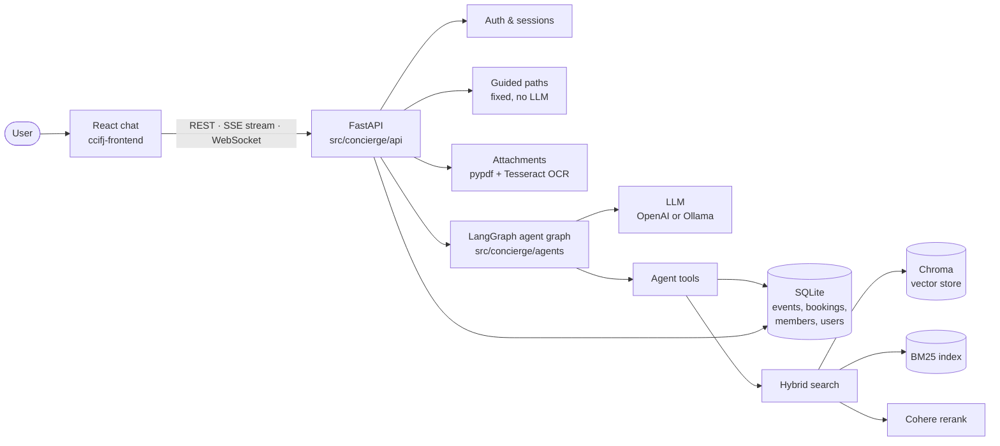
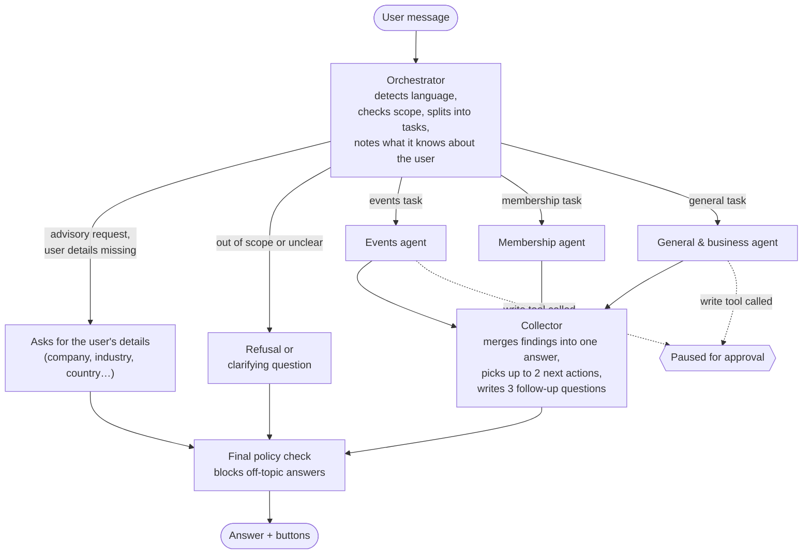
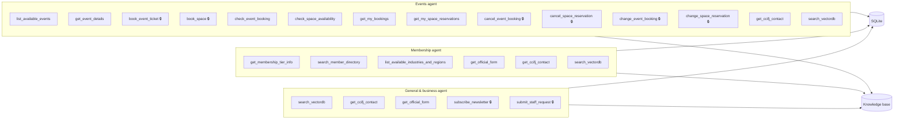
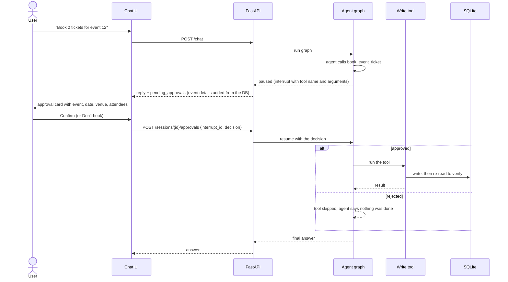
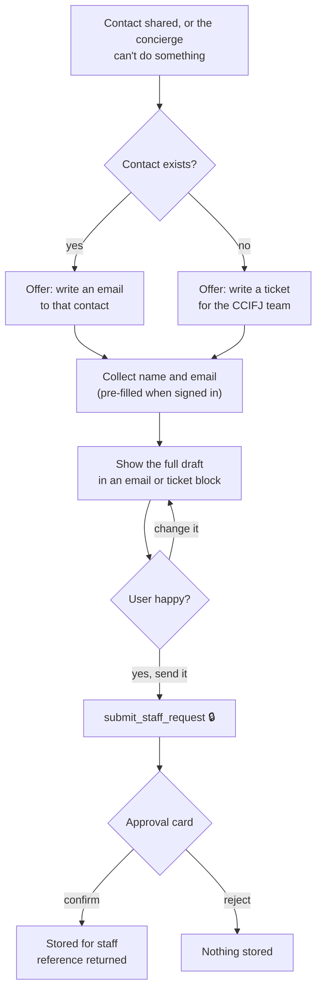
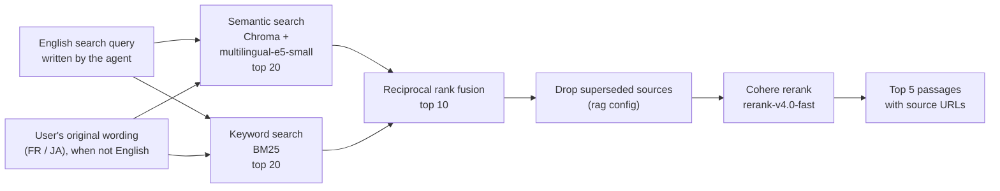

# How the CCIFJ Concierge works

The technical reference: how a message is answered, what each agent and tool does, how approvals,
search and the database work, and where the code lives. To run and use the concierge, start with
the [README](../README.md).

## Contents

- [Architecture](#architecture)
- [How a message is answered](#how-a-message-is-answered)
- [Agents and tools](#agents-and-tools)
- [Approvals (human in the loop)](#approvals-human-in-the-loop)
- [Writing to CCIFJ staff](#writing-to-ccifj-staff)
- [Staff dashboard](#staff-dashboard)
- [Knowledge search (RAG)](#knowledge-search-rag)
- [Personal answers](#personal-answers)
- [How answers are written](#how-answers-are-written)
- [Buttons under an answer](#buttons-under-an-answer)
- [How members and events are matched](#how-members-and-events-are-matched)
- [Loading content in bulk](#loading-content-in-bulk)
- [Project structure](#project-structure)
- [API overview](#api-overview)
- [Database](#database)

---

## Architecture



| Layer | Technology |
|---|---|
| Frontend | React 18, TypeScript, Vite, lucide-react |
| API | FastAPI, Uvicorn, SQLModel / SQLAlchemy (async), Alembic |
| Agents | LangGraph, LangChain (`create_agent`, `HumanInTheLoopMiddleware`) |
| Models | OpenAI chat models (default), or local Qwen through Ollama |
| Retrieval | Chroma + `intfloat/multilingual-e5-small` embeddings, BM25 (`bm25s`), Cohere `rerank-v4.0-fast` |
| Files | pypdf, pypdfium2, Pillow, Tesseract (`eng+fra+jpn`), built-in DOCX and UTF-8 text reading |
| Tracing | LangSmith (optional) |

---

## How a message is answered

Common read-only questions about fees, joining, booking guidance and the event
calendar use direct database or reviewed responses without model initialization.
Other messages use the LangGraph graph (`src/concierge/agents/body.py`). A bounded
conversation brief carries user-supplied facts and corrections across turns.



1. **Orchestrator.** Detects the user's language and decides whether the request is in scope. It splits a request into tasks for one or more specialists: *"show me events and membership fees"* runs both in parallel. A market-entry or partner-finding request with a known industry goes to all three specialists: support services, member companies in that industry, and matching events and committees. It also notes which details about the user matter for the request (industry, home country, B2B or B2C, stage, timeline...), which ones are already known from the profile or the conversation, and which are missing.
2. **Knowing the user first.** For an advisory request (*"I want to expand to Japan"*) with important details missing, the orchestrator first asks for them, once, and says the user can skip. Whatever the user replies, the next turn answers, tailored to what they shared, and ends by recommending the details that are still missing. Factual and transactional requests are never held up. Off-topic requests get a polite refusal.
3. **Specialist agents.** Each one is a LangChain agent with its own prompt and tools (see below). It sees the recent conversation, any attached files, and the user's profile.
4. **Collector.** Passes through a single specialist's final answer, or merges multiple specialists' findings into one answer. Multi-domain synthesis may propose up to 2 next actions; event booking actions remain checked against database records and authentication.
5. **Final policy check.** A second, cheaper model call makes sure the answer stays within CCIFJ topics. It uses the same scope definition as the orchestrator (`SCOPE_DEFINITION`) and also sees the previous assistant message, so follow-ups like "help me write an email to Nicolas" aren't mistaken for new, unrelated requests. Answers that only ask the user questions, staff drafts, and help for job seekers are always allowed; it blocks only answers that fulfill a plainly unrelated request (homework, coding, trivia).
6. **Pause.** If an agent calls a tool that writes to the database, the graph pauses and the user sees an approval card (see [Approvals](#approvals-human-in-the-loop)).

---

## Agents and tools



🔒 = needs the user's approval before it runs. Every agent also has
`return_to_main_menu`, which hands the conversation back to the orchestrator.

| Tool | Agent | What it does |
|---|---|---|
| `list_available_events` | Events | Upcoming events, 10 per page. Filters: `keyword` (comma-separated topic words searched in title and description as whole words, e.g. `"F&B, food, wine"`), `name`, `category` (the event **format**: Business event, Conference, Networking, Training; a topic passed here is rejected with the valid list), `location` (a city, venue, or region: Kanto, Kansai, Chubu, Kyushu, Hokkaido), and dates. |
| `get_event_details` | Events | One event's schedule, venue, price, registration deadline, languages, and speakers. |
| `book_event_ticket` 🔒 | Events | Books one ticket per attendee (name and email; phone optional). Requires login. Checks the registration deadline. |
| `book_space` 🔒 | Events | Reserves L'Espace@CCIFJ for a date range. Requires login. The database prevents overlapping reservations. |
| `check_event_booking` | Events | Whether the user can book an event: it exists, hasn't started, registration is open, not already booked, and any clash with their other bookings or reservations. Guests get only the registration status. |
| `check_space_availability` | Events | Whether a space is free for a time range: taken times, free gaps, and the next free slot of the same length. Guests may use it; other people's private reservations show only as "reserved". |
| `get_my_bookings` | Events | The user's bookings with reference (`CCIFJ-EVT-…`), event, date, and attendees. Can include past or cancelled ones. |
| `get_my_space_reservations` | Events | The user's room reservations with reference (`CCIFJ-SPC-…`), dates, and title. |
| `cancel_event_booking` 🔒 | Events | Cancels a whole booking (all tickets), allowed until the event starts. |
| `cancel_space_reservation` 🔒 | Events | Cancels a room reservation, allowed until it starts. |
| `change_event_booking` 🔒 | Events | Moves a booking to another event and/or replaces its attendee list, in one step. |
| `change_space_reservation` 🔒 | Events | Moves a reservation to new dates, or changes its title or attendee count, in one step. |
| `get_ccifj_contact` | Events, Membership, General | The direct contact for a topic: `events`, `become_speaker`, `become_sponsor`, `bonjour_france`, `membership`, `corporate_news`, `japanese_market_support`, `recruitment_and_hr`. |
| `search_vectordb` | Events, Membership, General | Hybrid search of the CCIFJ website and knowledge base (see [Knowledge search](#knowledge-search-rag)). |
| `get_membership_tier_info` | Membership | Membership categories, annual dues in JPY, eligibility, and benefits. |
| `search_member_directory` | Membership | Member companies by industry and/or place. Places are stored as address parts (Tokyo wards like `Minato-ku`, cities, French towns), so a region is matched as the wards and cities inside it ("Tokyo" covers the 23 wards; "Kansai" covers Osaka, Kyoto, Kobe, Nara…), as whole words. "Japan" means no filter. If a place has no members in that industry, it returns the industry's members elsewhere, with a note. |
| `list_available_industries_and_regions` | Membership | The directory industries, and the region names `search_member_directory` understands. |
| `get_official_form` | Membership, General | Official form links: membership application, business development inquiry, CV database. |
| `subscribe_newsletter` 🔒 | General | Subscribes an email to a CCIFJ newsletter. Requires login. |
| `submit_staff_request` 🔒 | General | Stores an email to one or more CCIFJ contacts, or a ticket for the team. Guests may use it. |

All write tools check their result after writing. If the result can't be
confirmed, they report it as uncertain and never retry on their own.

**Changing a booking.** The two `change_*` tools cancel the old booking and
create a new one behind the scenes. If the new one fails, the old one is
restored automatically. The user sees one approval card and hears "your booking
was changed", with a new reference. The agent checks first
(`check_event_booking`, `check_space_availability`) so it doesn't collect
details for something that can't go through.

---

## Approvals (human in the loop)

Tools that change data are wrapped in LangChain's `HumanInTheLoopMiddleware`
(`src/concierge/agents/langchain_agents.py`). Nothing is written until the user
confirms.



The approval card shows exactly what will happen before the user confirms:

| Action | The card shows |
|---|---|
| Book tickets | Event title, date, venue, price, registration deadline, and every attendee |
| Reserve a room | Space, start and end, title, attendees |
| Newsletter | The email and the newsletter name |
| Staff request | Type, To, From, Subject, and the full message |
| Cancel | The booking or reservation that will be cancelled |
| Change | Current → new, as one change |

Event and room details come from the database, not from the model. Booking,
room, newsletter, cancel, and change approvals need login. Guests can approve
staff requests only.

The paused state is kept in memory (`MemorySaver`), so run the API with **one
worker**.

---

## Writing to CCIFJ staff

When the concierge can't help on its own, it offers to write a message to the
right person together with the user. Examples: the registration deadline has
passed but the event hasn't happened yet, the user wants to cancel or change a
booking that has already started, asks for a refund, or no contact fits the
question.



Drafts always use the same layout, so they're easy to tell apart from the rest
of the answer:

````text
```email
To: t.funabashi@ccifj.or.jp; m.barges@ccifj.or.jp
From: Jane Doe <jane@example.com>
Subject: Membership category for a newly established company

Dear Ms. Funabashi and Ms. Barges,
...
```
````

The chat shows each draft as an email or ticket card with a Copy button. When
the user agrees, the request is saved in the `staff_request` table (one
`staff_request_recipient` row per contact), linked to the user (if signed in)
and the conversation. The user gets a reference such as `SR-2026-000001`.
Before the first draft, the concierge asks once which language to write it in:
English, French, or Japanese. Any natural reply works: a language name in any
language, a code such as `en` or `jp`, "ok" for the recommended language, or
"you choose" for the language of the conversation. Bare answers are matched
directly and looser ones are read by the model. The question is never asked
twice: if a reply names no language, the concierge keeps the draft, says which
language it used and offers the other two.

For a signed-in user, the first draft already carries the account's name, email,
phone and member company in the `From:` line and signature, and the concierge
says it used them. Placeholders are kept only for details the account does not
hold, for guests, or when the user asks for them.

Staff read each request, and the whole conversation that led to it, in the
dashboard.

Requests are only stored for staff to review. No email is sent automatically.

---

## Staff dashboard

Staff accounts get a **Dashboard** button in the header. Everything there works
without code, and every change is used by the agent on the next answer.

| Section | What staff do there |
|---|---|
| **Overview** | See the day's activity at a glance. |
| **Agent analytics** | See how visitors use the assistant and what it achieves, from the app's own records, with model costs and errors from LangSmith. |
| **Requests** | Read the requests visitors confirmed, with recipients and references, and move each one from new to in review to closed. The **Conversations** tab shows what visitors asked and what the agent answered, with the sources it cited; each request also opens the conversation it came from. |
| **Matching & intros** | Describe what someone needs and get the member companies that fit, with reasons; select companies and get a drafted introduction for the person who asked, or one invitation per company for an event. Follow the introduction requests members made through the chat. |
| **Onboarding & automation** | Switch engagement rules on or off, run them for today or for a later date to preview what they would do, review the drafted messages in the outbox, and see each member's activity score. |
| **Events** | Add and edit events, or import them from a spreadsheet. The agent reads them live. **Cancel event** withdraws one without deleting it: it is no longer listed, recommended or bookable, and its bookings stay. |
| **Member companies** | Browse and import the member directory, and link a person's account to their company, which starts their onboarding. **Hide** removes a company from the agent's search and matching without deleting it. |
| **Knowledge files** | Upload brochures, price lists and procedures (PDF, Word, text, images; scans are OCR'd), or link a Calameo publication, a web page or a PDF. Linked sources show when they were last checked and have a **Sync now** button. |
| **Accounts & roles** | See accounts and give or remove staff access. |
| **Staff directory** | Maintain the contacts the agent routes requests to, by topic, with a triage contact for anything else. |

The conversation view shows the visitor's messages and the agent's answers,
never the agent's internal tool messages. Conversations of signed-in users are
kept. A guest conversation is deleted when the page closes unless the visitor
confirmed a request; then it is kept with the request, and the approval card
says so before the visitor confirms.

---

## Knowledge search (RAG)

`search_vectordb` (`src/concierge/rag/`) combines meaning-based search with
keyword search, then reranks the results.



Two collections are searched together: the crawled CCIFJ website
(`src/concierge/data/documents.jsonl`, split into `chunks.json`; the English
pages) and the **documents staff upload** in the admin dashboard or with
`scripts/ingest_documents.py` (brochures, price lists, procedures, in any
language; scanned PDFs are OCR'd). The agent writes its query in English for the
website index and also passes the user's original wording (`original_query`)
when they wrote in French or Japanese: the multilingual embedding matches it
across languages and keyword search matches uploaded documents written in that
language. Every result list joins the same rank fusion. The agents always answer
in the user's language.

Staff can also **link a source instead of uploading it**
(`src/concierge/linked_sources.py`): a Calameo publication, a web page, or a
direct link to a PDF or Word file. The link is read and indexed like an upload,
then checked again every 6 hours (`CCIFJ_LINK_SYNC_HOURS`) or when staff press
**Sync now**. It is re-indexed only when its content changed, and a failed check
keeps the last good version, so staff update the source once and the agent
follows. For a Calameo publication the agent indexes the title and summary from
its public page, and the full text when staff add a link to the PDF; with
`CALAMEO_API_KEY` and `CALAMEO_API_SECRET` it uses the official Calameo API,
which also covers private publications. Only public https addresses are fetched.

Sources that newer CCIFJ documents supersede (for example the 2017 domiciliation
brochure with an old membership fee) are listed in
`rag/src/config.py:OUTDATED_SOURCE_URLS` and dropped at search time, so no
re-index is needed to retire a document.

The Chroma collection is opened once per process (`rag_search.get_collection`,
also loaded by the startup warm-up). Opening a new client for every search used
to crash when an agent ran two searches in parallel.

**Which source wins.** CCIFJ records in SQLite (events, membership categories
and fees, the member directory, contacts, forms, the user's bookings) are the
source of truth. Website search is background only. When the two disagree on a
fact such as a fee or a date, the agents use the record and don't mention the
difference.

---

## Personal answers

For a signed-in user, the API loads a small profile on every turn
(`crud.load_user_context`): name, email, membership (company, its industry,
country and region, and tier), newsletter status, upcoming bookings (with days
until each one), upcoming room reservations, **interests** (the event categories
they book most), and up to two **recommended events** (upcoming, registration
open, in those categories, not yet booked). Every prompt also gets the current
date and time in Japan and the turn number.

The concierge uses this to:
- avoid asking for details it already knows (a member's industry or country);
- avoid offering what the user already has (joining when already a member,
  booking an event they already booked, subscribing twice);
- pre-fill their name and email in bookings and staff requests;
- add **at most one** short personal note, such as a booked event coming up in
  the next 7 days, a registration deadline that's close, or an upcoming event
  that matches their interests.

**Knowing the user.** For advisory questions, the orchestrator decides which
details would change the answer (`known_user_details`, `missing_user_details`
in its plan). It does not hold the answer back for them: the specialist gets
the known and missing details with its task, answers with guidance that holds
in general, and ends with one question about the detail that would change the
advice. A detail the user declined is not asked again.

Guests get the same answers, without the personal parts. A guest who tries to
book is asked to sign in and keeps the same conversation; after signing in from
the chat, the widget continues it automatically.

---

## How answers are written

The collector's prompt (`COLLECTOR_SYSTEM_PROMPT` in `schema_prompts.py`) and
the shared blocks every agent gets (`CCIFJ_SERVICES_MAP`,
`PERSONALIZATION_GUIDE`, `USER_FACING_RULES`) set these rules:

| Rule | What it means |
|---|---|
| Build on the conversation | The collector sees the last 3 exchanges. It doesn't repeat earlier advice, links, or offers, and doesn't ask again for details the user skipped. |
| Short | About 250 words, the 2–3 recommendations that matter most, at most 3 items per list; the rest is offered as a follow-up. |
| Name members | When the directory found relevant members, the 2 most relevant are named, exactly as written, with their sector and a caveat that they're possible contacts. |
| End with a question | Every answer ends with one question that moves the user forward (a draft, a deeper topic). |
| No internals | Never mention databases, the knowledge base, tools, agents, or event IDs, and never say information "was not provided". Say what the user can do instead. |
| Exact names | Company, event, and people's names are copied character for character. |
| Links | Each URL once, as a Markdown link with a descriptive title; an event is linked on its title. |

---

## Buttons under an answer

| Kind | Source | Limit |
|---|---|---|
| **Next actions** (filled buttons) | The collector, from a fixed list: `event.view`, `event.book`, `events.browse`, `space.book`, `membership.join`, `membership.benefits`, `newsletter.subscribe`, `contact.staff`, `auth.login` | up to 2 |
| **Suggested questions** | Written by the model for this user, in their language: 3 related CCIFJ topics, spread across sections, that the answer and earlier turns haven't covered | at least 2 |

Three buttons in all, but there's always room for 2 suggested questions, so 2
actions + 2 questions is the most. Actions are checked against the user's real
situation before they're shown: no booking button for guests, no "join" for
members, no event button for an ID that isn't in the results, and no
`contact.staff` while a draft is already on screen. Action prompts name an
event by its title, never its ID, because the user sees them as their own
message.

**Useful links.** Links in the answer also appear as chips
(`api/presentation.py`, `NextActions.tsx`), but only when there are 2 or more
(a single link is already visible in the text):
- each page once (a trailing slash or `#anchor` doesn't make a new page);
- generic link text ("event page", "here", "details") is replaced by the page's
  own name from its URL;
- links that share a label are told apart by page name or section
  ("Events · Contact us", "Membership · Contact us");
- at most 3 at a time, with a "Show N more" toggle.

---

## How members and events are matched

`src/concierge/matching.py` ranks member companies and upcoming events against a need written
in plain language ("a distributor for our food products", "solar power for our offices"), in
English, French or Japanese. Nothing has to be typed the way the directory spells it:

| Signal | What it adds |
|---|---|
| Meaning | Multilingual embeddings: a French or Japanese need matches an English description; "agrifood" matches "Food & Beverage". |
| Wording | Stemmed terms weighted by rarity, widened with a small English/French vocabulary (distributeur = distributor = importer). A company that says "solar" outranks one that only says "energy". |
| Sector | Primary and secondary sectors, resolved loosely from the user's words. |

The first two rankings are fused by reciprocal rank and a sector named in the need adds a
bonus. Each match keeps the terms it matched and a sentence from the company's own
description, so the agent explains the fit instead of guessing, and lists the company's
contact people with their role and working language. Contact job titles are deliberately not
part of the matching text (a bank with an "HR Director" is not an HR provider).

The same ranking suggests events: `recommend_events`, the event list when no event contains
the user's exact keywords ("closest by topic", labelled as such), and the two events
recommended to a signed-in user, which now follow their company's sectors, their onboarding
interests and what they booked before, instead of only the event formats they attended.

---

## Loading content in bulk

Everything below can also be done in the admin dashboard; the scripts exist for
bulk loading.

```bash
# Member directory: the organisers' 50 fictional companies with their contact people (kept in the repository).
# Pass another CSV/XLSX export as an argument to load that instead; without --yes it only previews.
uv run python scripts/replace_members.py --yes
```

```bash
# Brochures and other documents (PDF, DOCX, text; scanned PDFs are OCR'd), deduplicated by content
uv run python scripts/ingest_documents.py "path/to/brochures"
```

```bash
# Events: compare every event with its page on ccifj.or.jp and report the differences (dates, venue,
# registration deadline, member / non-member prices, contact, languages); --apply writes them,
# --add-new also creates upcoming events that are on the site but not in the database yet.
uv run python scripts/refresh_events.py --apply --add-new
```

Staff contacts (department, what they handle, email, triage flag) are edited in
**Admin → Staff contacts**; the agent reads them live.

---

## Project structure

```text
src/concierge/
├── agents/              LangGraph graph, prompts, specialist agents, tools
│   ├── body.py              graph nodes: orchestrator, workers, collector, policy
│   ├── langchain_agents.py  the three specialist agents and their approval rules
│   ├── schema_prompts.py    prompts, structured outputs, next-action list
│   ├── tools.py             every agent tool
│   └── model.py             LLM setup (OpenAI or Ollama)
├── api/                 FastAPI routes: auth, sessions, chat, approvals, guided paths, attachments
├── auth/                password hashing and signed tokens
├── db/
│   ├── relationaldb/        SQLModel models, CRUD, Alembic migrations, demo seed, system.db
│   └── vectordb/            Chroma vector store
├── integrations/        optional Odoo CRM connector
├── rag/                 hybrid retrieval (Chroma + BM25 + Cohere) and indexing
├── knowledge.py         documents staff add: chunking, embedding, keyword index
├── linked_sources.py    knowledge linked by URL (Calameo, web pages, PDFs) and its scheduled re-sync
├── matching.py          member matching (Agent 3)
├── engagement.py        onboarding and engagement rules (Agent 2)
├── data/                crawled documents, chunks, Q&A catalogs, guided conversation paths
├── index/               BM25 index
├── config.py            settings from .env, checked at startup
└── main.py              FastAPI app
ccifj-frontend/          React + TypeScript chat site and admin dashboard
tests/                   API contract tests (fake agent, throwaway database); fixtures/faq_scenarios.json is the organisers' question bank
scripts/
├── verify.sh                backend tests, corpus check, frontend build and tests
├── evaluate.py              corpus / retrieval / API evaluation on 100 labelled questions
├── faq_check.py             runs the 71 recurring questions + 5 fallback cases through the live API
├── ingest_documents.py      loads a folder of brochures into the knowledge base (same as the dashboard upload)
├── replace_members.py       replaces the member directory with a CSV/XLSX export, companies and their contact people
└── refresh_events.py        checks every event against its ccifj.or.jp page, fixes dates, venues, deadlines and prices, adds new events
docs/                    ARCHITECTURE.md (this file), HACKATHON.md (demo runbook) and DEPLOYMENT.md (installation, costs, handover)
demo/                    live evaluation scripts and their results (live_eval_results.md)
start.sh                 starts the whole stack with one command
```

---

## API overview

Every route is available both at the root and under `/api/v1`. Full reference:
[`src/concierge/api/README.md`](../src/concierge/api/README.md).

| Method | Route | Purpose |
|---|---|---|
| `GET` | `/health`, `/status` | Health; `/status` also reports `agent_ready` |
| `GET` | `/suggestions?locale=` | Catalog questions and guided-path starters for the welcome screen |
| `POST` | `/auth/register`, `/auth/login` | Create an account or sign in |
| `GET` | `/auth/me` | Current user |
| `POST` | `/sessions` | Start a conversation |
| `GET` | `/sessions/{id}/messages` | Conversation history |
| `POST` | `/sessions/{id}/claim` | Attach a guest conversation to an account after login |
| `POST` | `/sessions/{id}/reconcile` | Check the outcome of an interrupted action |
| `POST` | `/chat` | Send a message (with optional attachments) |
| `POST` | `/chat/stream` | Same, streamed as server-sent events (progress and text) |
| `WS` | `/chat/ws` | Same, over WebSocket |
| `GET` | `/sessions/{id}/approvals[/{interrupt_id}]` | Pending approvals |
| `POST` | `/sessions/{id}/approvals` | Approve or reject a pending action |
| `GET`, `PATCH` | `/staff/requests[/{reference}]` | Staff: list confirmed requests, change a request's status |
| `GET` | `/staff/conversations[/{id}]` | Staff: list saved conversations, read one transcript with its sources |
| `GET`, `POST`, `PUT` | `/admin/events` | Staff: list, add and edit events |
| `GET`, `POST` | `/admin/members`, `/admin/import/{events\|members}` | Staff: browse the member directory, import a spreadsheet |
| `GET`, `POST`, `DELETE` | `/admin/knowledge[/{id}]` | Staff: list, upload and remove knowledge documents |
| `POST` | `/admin/knowledge/link`, `/admin/knowledge/{id}/sync` | Staff: add a linked source, re-read it now |
| `GET`, `POST` | `/admin/matching/…`, `/admin/intro-requests` | Staff: find matching members, draft proposals and invitations, follow introductions |
| `GET`, `POST`, `PATCH` | `/admin/automation/…`, `/admin/outreach` | Staff: engagement rules, runs and the message outbox |
| `GET`, `POST`, `PATCH` | `/admin/users`, `/admin/staff-contacts` | Staff: accounts and roles, the staff directory |
| `GET` | `/admin/overview`, `/admin/analytics` | Staff: dashboard overview and agent analytics |

---

## Database

SQLite (`src/concierge/db/relationaldb/system.db`), with these tables:
`user`, `user_auth`, `session`, `message`, `event`, `event_language`,
`booking`, `ticket`, `member`, `member_category`, `belongs`, `speaker`,
`speaks_at`, `subscription`, `contact_us`, `space`, `space_reservation`,
`staff_request`, `staff_request_recipient`.

Guest sessions are deleted when the guest closes the app, and a guest's chat is
assigned to them as soon as they log in. See
[`src/concierge/db/README.md`](../src/concierge/db/README.md) for the session
lifecycle and a changelog of database behavior changes.

### Schema updates

Run `uv run concierge-db upgrade` before starting the application, including
after pulling schema changes. It creates new databases and migrates existing
ones without replacing records.

After changing SQLModel models, generate a migration:

```bash
uv run concierge-db revision --autogenerate -m "describe the change"
```

Review it, including data conversions, before running
`uv run concierge-db upgrade`. SQLite table changes use Alembic batch mode.
Custom triggers and data migrations must be written into the revision by hand.
If you rebuild `space_reservation`, recreate its reservation guards afterward.
Use `uv run concierge-db current` to see the installed revision. Back up the
database before deploying schema changes, and apply migrations once before
starting the server.

### Dates and times

Event dates, registration deadlines, and room schedules are stored as naive
**Japan time (UTC+9)**. Dates that include a time zone are converted to Japan
time first. Creation and update timestamps stay in UTC. Registration closes at
the deadline, or at the event's end time when there is no deadline. The
database blocks overlapping confirmed room reservations, even across several
processes.

> `system.db` and the Chroma files change whenever you use the app. Avoid
> committing those local changes: add files by name instead of `git add .`.
