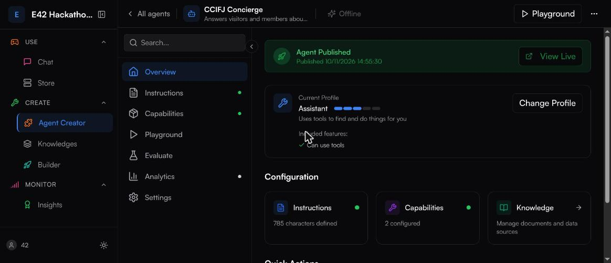
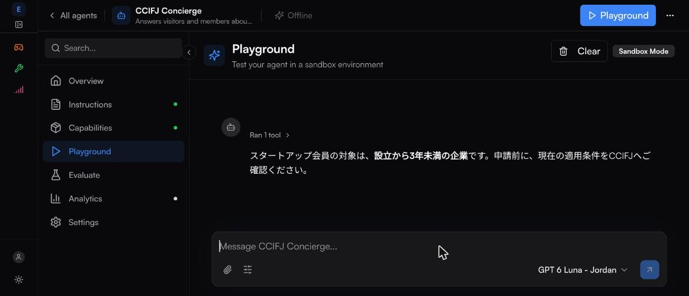

# The concierge as a Prisme.ai agent

CCIFJ already uses Prisme.ai. This folder holds everything needed to run the
concierge as an agent inside a Prisme workspace, so staff can use it where
they already work and another chamber can set up the same agent.


*Prisme Playground, 10 November 2026: the agent calls the backend ("Ran 1
tool") and shows its answer to "What are the membership fees?".*

## How it works

```text
User in Prisme  ->  Prisme agent "CCIFJ Concierge" (profile: Assistant)
                      |  custom function ask_ccifj_concierge
                      v
                    POST https://<concierge host>/api/v1/chat   {message, locale, session_id?}
                      |
                      v
                    the concierge backend (agents, search, sources)  ->  {reply, session_id, ...}
```

The Prisme agent holds no CCIFJ facts of its own. It passes each message to the
backend and shows the reply, so answers in Prisme are the same as on the
website and information is updated in one place.

## Set it up (about ten minutes)

1. **Agent Creator -> Create agent -> From scratch**, profile **Assistant**
   ("uses tools"). Name `CCIFJ Concierge`.
2. **Instructions**: paste [`agent-instructions.md`](agent-instructions.md).
3. **Capabilities -> Add -> Custom Function**, with the values in
   [`custom-function.json`](custom-function.json): display name, function name,
   endpoint URL, description, the `Content-Type` header, and the parameters
   schema (paste it as is).
4. **Playground**: ask `What are the membership fees?`. "Ran 1 tool" above the
   answer means the backend was called.
5. Publish the agent when the test passes.

The endpoint URL is the backend's public address followed by `/api/v1/chat`.

## The backend's address

Prisme calls the backend over the internet, so the backend needs a public
address.

- **Deployed backend (production).** Use its own address. It is set once in the
  function and never changes.
- **Backend on a laptop (the hackathon set-up).** Start the concierge with
  `./start.sh`, then run:

  ```bash
  prisme/tunnel.sh
  ```

  It opens a Cloudflare quick tunnel in the background (no account needed) and
  prints the Endpoint URL to paste into the function. Run it again at any time
  to see the address and check that it still answers; `prisme/tunnel.sh stop`
  closes it. The address stays the same until the tunnel is stopped or the
  laptop sleeps or restarts. A new start gives a new address: paste it into
  **Capabilities -> Ask the CCIFJ Concierge -> Endpoint URL**, press **Update**,
  then **... -> Publish Changes**.
- **A fixed address on a laptop.** This needs a Cloudflare account and a domain
  managed by Cloudflare; it was not set up during the hackathon. With both:

  ```bash
  cloudflared tunnel login
  cloudflared tunnel create ccifj-concierge
  cloudflared tunnel route dns ccifj-concierge concierge.example.org
  cloudflared tunnel --url http://127.0.0.1:8001 run ccifj-concierge
  ```

  The function's URL is then `https://concierge.example.org/api/v1/chat` for good.

While a tunnel is open, anyone who has the address can use the concierge and
the model credits behind it. Close it when the demonstration is over.

## Reuse by another chamber

[`CCIFJ_Concierge.agents.md`](CCIFJ_Concierge.agents.md) is the agent exported
from Prisme: its instructions, the custom function and its parameters in one
file. Import it with **Agent Creator -> Create agent -> Import AGENTS.md**
instead of steps 1 to 3 above, then set the function's `url` (the export in
this folder has `https://YOUR-CONCIERGE-HOST` in place of the hackathon address).

The import was tested on 10 November 2026: the file in this folder was imported
as a new agent, the function's `url` was set, and the new agent answered
`CCIFJの年会費はいくらですか？` in Japanese with the fee table from the backend.
Instructions, function, header and parameters all came through the import;
nothing else had to be entered.


Three things are specific to CCIFJ: the agent's name, the fallback contact in
the instructions, and the endpoint URL. A chamber that runs its own copy of the
backend changes those three and has the same agent.

## Limits

- Text only. Approval cards, sign-in, and the buttons under answers exist in
  the web chat, so bookings and stored requests cannot be completed from Prisme.
- The agent stops answering when the backend is unreachable (the laptop is
  off, or the tunnel address changed); it then gives the fallback contact.
- Every reply passes through two models (Prisme's, then the backend's), so it
  is slightly slower than the web chat.
- Tested in the Playground on 10 and 11 November 2026 (see below). It is
  published in the hackathon workspace with access restricted to approved
  members, and its owner is the only one. It has not been tried by CCIFJ staff.

## What was tested

One Playground conversation, 10 November 2026:

| Question | Result |
| --- | --- |
| `What are the membership fees?` | The fee table from the backend, in English. |
| `Qui contacter pour sponsoriser un événement ?` | Marie OZAKI and Elena SUZUKI with email and phone, in French. |
| `Et quel est son numéro de téléphone ?` | Both phone numbers; "son" was understood from the previous answer. |

The backend stored all three questions in a single conversation, so the agent
passes `session_id` back on follow-up questions and the language is kept.



*Agent overview after publishing, 10 November 2026.*

### Checked again on 11 November 2026

- **Against the code on `main`.** The requests the function sends (`message`
  and `locale`, then `session_id` on the follow-up) were sent straight to the
  chat endpoint. A question in French was answered in French and the follow-up
  stayed in the same conversation. The same call through the address printed
  by `prisme/tunnel.sh` returned the fee list.
- **In Prisme.** A new tunnel address was pasted into the function and
  published. The published agent then answered `What are the membership fees?`
  and, in the same conversation, `スタートアップ会員の条件は何ですか？` in Japanese.
  The backend stored both in one conversation. The backend running for this
  check was a development build with the same chat endpoint.



## A standalone variant (not in use)

[`agent-instructions-standalone.md`](agent-instructions-standalone.md) and the
documents in [`knowledge/`](knowledge/) are for an agent that answers from a
Prisme knowledge base without the backend. It was not finished: indexing failed
in the hackathon workspace with "Embedding generation failed: UnknownModel" for
both embedding models tried.
