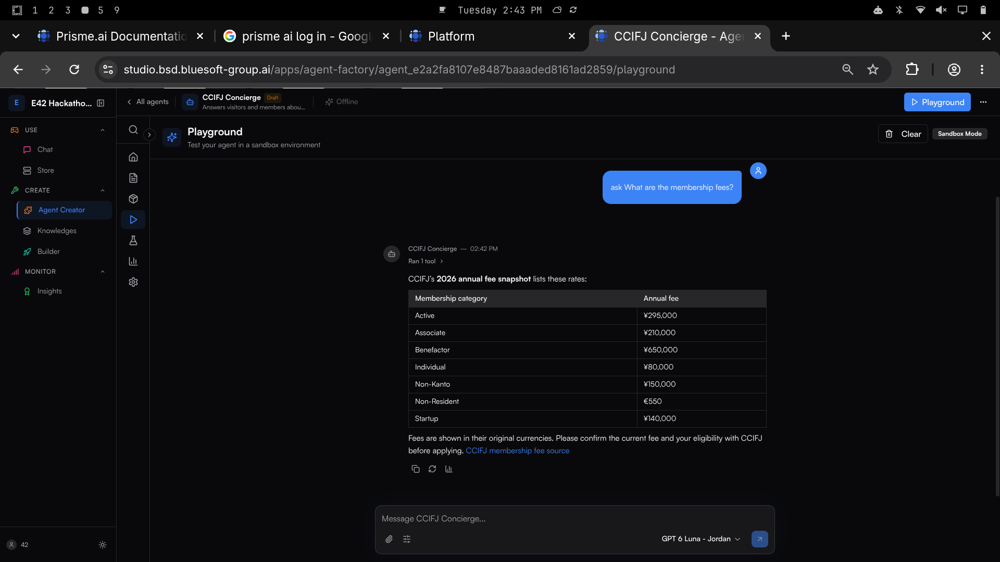
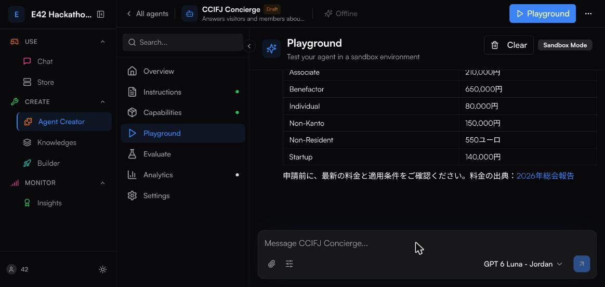

# The concierge as a Prisme.ai agent

CCIFJ already uses Prisme.ai. This folder holds everything needed to run the
concierge as an agent inside a Prisme workspace, so staff can use it where
they already work and another chamber can set up the same agent.



*Prisme Playground, 10 November 2026: the agent calls the backend ("Ran 1
tool") and shows its answer to "What are the membership fees?".*

## How it works

```text
User in Prisme  ->  Prisme agent "CCIFJ Concierge" (profile: Assistant)
                      |  custom function ask_ccifj_concierge
                      v
                    POST https://<concierge host>/api/v1/chat   {message, locale, session_id?}
                      |
                      v
                    the concierge backend (agents, search, sources)  ->  {reply, session_id, ...}
```

The Prisme agent holds no CCIFJ facts of its own. It passes each message to the
backend and shows the reply, so answers in Prisme are the same as on the
website and information is updated in one place.

## Set it up (about ten minutes)

1. **Agent Creator -> Create agent -> From scratch**, profile **Assistant**
   ("uses tools"). Name `CCIFJ Concierge`.
2. **Instructions**: paste [`agent-instructions.md`](agent-instructions.md).
3. **Capabilities -> Add -> Custom Function**, with the values in
   [`custom-function.json`](custom-function.json): display name, function name,
   endpoint URL, description, the `Content-Type` header, and the parameters
   schema (paste it as is).
4. **Playground**: ask `What are the membership fees?`. "Ran 1 tool" above the
   answer means the backend was called.
5. Publish the agent when the test passes.

The endpoint URL must be reachable from the internet. During the hackathon the
backend ran on a laptop behind a Cloudflare quick tunnel
(`cloudflared tunnel --url http://127.0.0.1:8001`), whose address changes at
every restart; in production it is the deployed backend's address.

## Reuse by another chamber

[`CCIFJ_Concierge.agents.md`](CCIFJ_Concierge.agents.md) is the agent exported
from Prisme: its instructions, the custom function and its parameters in one
file. Import it with **Agent Creator -> Create agent -> Import AGENTS.md**
instead of steps 1 to 3 above, then set the function's `url` (the export in
this folder has `https://YOUR-CONCIERGE-HOST` in place of the hackathon address).

The import was tested on 10 November 2026: the file in this folder was imported
as a new agent, the function's `url` was set, and the new agent answered
`CCIFJの年会費はいくらですか？` in Japanese with the fee table from the backend.
Instructions, function, header and parameters all came through the import;
nothing else had to be entered.



Three things are specific to CCIFJ: the agent's name, the fallback contact in
the instructions, and the endpoint URL. A chamber that runs its own copy of the
backend changes those three and has the same agent.

## Limits

- Text only. Approval cards, sign-in, and the buttons under answers exist in
  the web chat, so bookings and stored requests cannot be completed from Prisme.
- The agent stops answering when the backend is unreachable; it then gives the
  fallback contact.
- Every reply passes through two models (Prisme's, then the backend's), so it
  is slightly slower than the web chat.
- Tested in the Playground with three questions on 10 November 2026 (see
  below) and published in the hackathon workspace the same day, shared with
  its owner only. It has not been tried by CCIFJ staff.

## What was tested

One Playground conversation, 10 November 2026:

| Question | Result |
| --- | --- |
| `What are the membership fees?` | The fee table from the backend, in English. |
| `Qui contacter pour sponsoriser un événement ?` | Marie OZAKI and Elena SUZUKI with email and phone, in French. |
| `Et quel est son numéro de téléphone ?` | Both phone numbers; "son" was understood from the previous answer. |

The backend stored all three questions in a single conversation, so the agent
passes `session_id` back on follow-up questions and the language is kept.


*Agent overview after publishing, 10 November 2026.*

## A standalone variant (not in use)

[`agent-instructions-standalone.md`](agent-instructions-standalone.md) and the
documents in [`knowledge/`](knowledge/) are for an agent that answers from a
Prisme knowledge base without the backend. It was not finished: indexing failed
in the hackathon workspace with "Embedding generation failed: UnknownModel" for
both embedding models tried.
